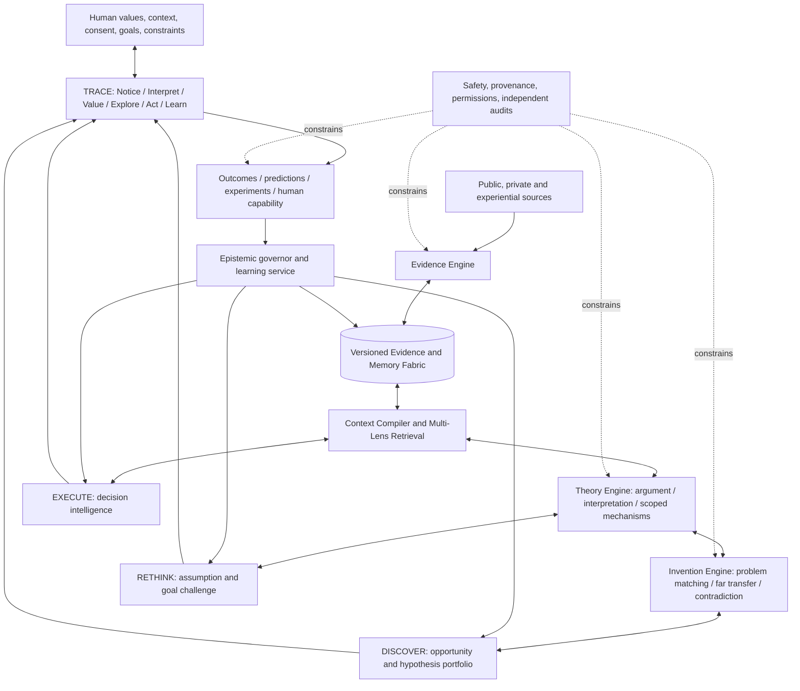
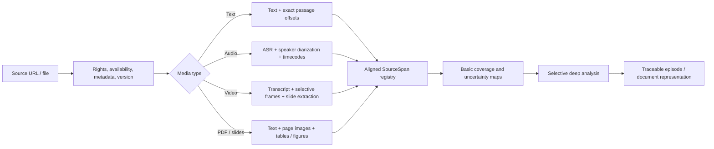
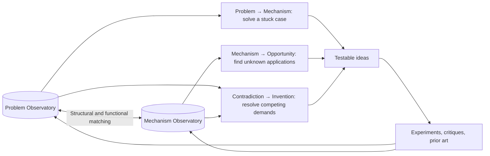

# WISDOM FOUNDRY 11
## A source-faithful, generative, self-correcting intelligence system for human wisdom, original problem solving, and real-world learning

**Final architecture and implementation blueprint | 3 November 2026 | Version 1.0**

> **Design north star:** Turn evidence, human experience, and difficult questions into better *human* judgment, newly available options, testable inventions, conditional capabilities, and measured improvement, without confusing interpretation with fact, novelty with truth, automation with progress, or the system's preferences with the human's values.
>
> **Foundational rule:** Preserve the source. Interpret with discipline. Abstract conditionally. Invent freely but label invention. Criticize independently. Test proportionately. Learn from outcomes. Keep the human capable of disagreeing and acting without the system.

**Status:** This is a proposed systems architecture, *not* an already-built or empirically validated “11/10” product. The ambition is extraordinary; superiority must be established against strong baselines. The design synthesizes the full user-supplied 2026-11-03 conversation, the original Knowlume and DeepSeek exchanges as represented there, the uploaded Breakthrough Engine skill and Wisdom Mining Protocol analysis, the TRACE diagram, GTTA transfer, the 100+ query research scans, and repository/source-code reviews including ChrisRoyse's portfolio. External project references are supplied as direct URLs. A repository's README, source files, test suite, paper, or vendor benchmark establishes different levels of evidence, and those distinctions are preserved below.


## Navigate the blueprint

| Sections |
|---|
| [1. First principles: derive the architecture from reality, not fashionable components](#1-first-principles-derive-the-architecture-from-reality-not-fashionable-components) |
| [2. Bird's-eye architecture](#2-birds-eye-architecture) |
| [3. TRACE: the human loop and the product's true value](#3-trace-the-human-loop-and-the-products-true-value) |
| [4. A minimal, rigorous epistemic operating system](#4-a-minimal-rigorous-epistemic-operating-system) |
| [5. Source ingestion and the Evidence Engine](#5-source-ingestion-and-the-evidence-engine) |
| [6. The Theory Engine: compile knowledge into qualified explanatory power](#6-the-theory-engine-compile-knowledge-into-qualified-explanatory-power) |
| [7. The Invention Engine: a serious breakthrough protocol](#7-the-invention-engine-a-serious-breakthrough-protocol) |
| [8. Decision intelligence: make research serve actual choices](#8-decision-intelligence-make-research-serve-actual-choices) |
| [9. Memory fabric, context compiler, and conditional skills](#9-memory-fabric-context-compiler-and-conditional-skills) |
| [10. Diagnostic router, GTTA control theory and bounded autonomy](#10-diagnostic-router-gtta-control-theory-and-bounded-autonomy) |
| [11. Outcome Laboratory: predictions, experiments, calibration and learning](#11-outcome-laboratory-predictions-experiments-calibration-and-learning) |
| [12. The full end-to-end Stoa playlist workflow](#12-the-full-end-to-end-stoa-playlist-workflow) |
| [13. Evaluation science: the system must beat strong baselines](#13-evaluation-science-the-system-must-beat-strong-baselines) |
| [14. Security, rights, governance and human agency](#14-security-rights-governance-and-human-agency) |
| [15. Technology strategy: build vs integrate vs study](#15-technology-strategy-build-vs-integrate-vs-study) |
| [16. Implementation blueprint: interfaces, events, data structures and control](#16-implementation-blueprint-interfaces-events-data-structures-and-control) |
| [17. Technology and research atlas: the best sources and what to take](#17-technology-and-research-atlas-the-best-sources-and-what-to-take) |
| [18. User experience: serious intelligence without another second inbox](#18-user-experience-serious-intelligence-without-another-second-inbox) |
| [19. Stage-gated roadmap: prove the difficult things before automating everything](#19-stage-gated-roadmap-prove-the-difficult-things-before-automating-everything) |
| [20. Key architecture decisions and the options rejected](#20-key-architecture-decisions-and-the-options-rejected) |
| [21. The strongest original product differentiators](#21-the-strongest-original-product-differentiators) |
| [22. The strongest reasons the system could still fail](#22-the-strongest-reasons-the-system-could-still-fail) |


---

# Executive decision

Build **one decision-and-discovery operating system with three interacting objectives, three epistemic engines, one human learning cycle, and a small set of shared infrastructural services**. Do not build one giant assistant prompt, dozens of mutually redundant agents, or a graph database in search of a problem.

### Three objective loops

1. **EXECUTE:** Improve actual pending decisions and progress toward human-chosen goals.
2. **DISCOVER:** Generate valuable options, questions, mechanisms, and opportunities not implied by current goals or search terms.
3. **RETHINK:** Challenge the adequacy of current interpretations, strategies, goals, measures of success, and the system's own behavior.

### Three cooperating epistemic engines

1. **EVIDENCE:** Preserve and reconstruct what sources *actually* communicate, including ambiguity and disagreement.
2. **THEORY:** Build provisional distinctions, functional patterns, scoped explanations, and conditional mechanisms, with evidence for and against.
3. **INVENTION:** Transform problem structures and combine distant mechanisms into possible solutions, then expose them to strong criticism.

### One human-centered learning cycle

**TRACE: NOTICE → INTERPRET → VALUE → EXPLORE → ACT → LEARN**, with feedback from any stage to any prior stage. This is *not* a narrow linear workflow or an AI-controlled optimization of personal values. It is the human developmental process the system supports.

### Shared horizontal services

- **Context Compiler:** Select task-appropriate, versioned evidence, interpretations, mechanisms, and skills.
- **Memory Fabric:** Preserve sources, beliefs, experiences, goals, failures, prospective triggers, and durable skills without collapsing them into one memory type.
- **Epistemic Governor:** Attribution, evidence polarity, independent-source checks, uncertainty, permissions, and promotion policies.
- **Diagnostic and Resource Controller:** Choose what kind of thinking is needed; allocate attention, money, compute, review, exploration, and action risk.
- **Outcome Laboratory:** Preregister predictions, design discriminating tests, learn conditional skills, calibrate claims, and audit what the system missed.
- **Independent Watchdog:** Monitor silent failure, overconfidence, preference drift, poisoned sources, unfair synthesis, skill decay, and regressions.

The key organizing choice is that **operationalization and memory are shared processes**, not competing fourth or fifth autonomous goal loops. We want fewer control centers and sharper responsibility boundaries.

## What the system must produce

| Output | Unlike ordinary AI summaries | Criterion for success |
|---|---|---|
| **Evidence-backed Understanding** | Reconstructs source arguments, changes of position, and alternative interpretations | Independent reviewers judge it faithful to source context |
| **Conditional Wisdom** | Captures what works *when*, why, for whom, under which constraints, and when not | Correct retrieval and qualified transfer across cases |
| **Problem Intelligence** | Recognizes the maintaining force, hidden constraint, value conflict, or missing fact | Useful problem diagnoses against independent experts |
| **Breakthrough Candidates** | Produces structurally diverse interventions and novel problem frames | Validated originality, feasibility, and actual experimental promise |
| **Decision Improvement** | Changes the set of options or the choice, not merely the answer's phrasing | Measurable decision lift and regret reduction against baseline |
| **Human Capability** | Leaves the person more competent, reflective, and autonomous | Improved unaided performance, not only AI-assisted performance |
| **Compounding Learning** | Learns from calibrated predictions, failed transfers, and real outcomes | Holdout-task improvements over time |

**Definition of the product:** A *living, versioned, epistemically governed, bidirectional problem–mechanism discovery system* joined to a human-centered decision and learning process.

---

# 1. First principles: derive the architecture from reality, not fashionable components

## 1.1 The actual problem is not too much information

It is the *gap between available experience and improved future choice*. Information can be abundant while the person still misidentifies the problem, confuses claims with evidence, reuses a method outside its conditions, cannot imagine an alternative, or never tests what is learned. Consequently, maximizing documents ingested, snippets extracted, graph edges, model context, or daily recommendations is **not** the objective.

A defensible conceptual objective is:

\[
\text{Net Human Value} \approx \text{Decision Lift} + \text{Option Value} + \text{Capability Growth} + \text{Avoided Harm} - \text{Attention Cost} - \text{Compute Cost} - \text{Error Cost} - \text{Dependency Cost}.
\]

This equation is a *design decomposition*, not a validated scalar utility function. The terms have different units, important ethical constraints cannot be traded for extra expected utility, and some outcomes resist precise quantification. Optimize a **constrained multi-objective portfolio** with explicit non-negotiable limits, not a magic “wisdom score.”

## 1.2 The twelve invariants

**I1. Source ≠ statement ≠ interpretation ≠ hypothesis ≠ empirical finding ≠ approved action.** Never silently promote across these boundaries. Every meaningful transformation is attributable and reversible.

**I2. Understanding precedes abstraction, but not all understanding is causal.** Philosophical distinctions, values, metaphors, and unresolved questions are legitimate knowledge products. Do not squeeze them into “cause X produces outcome Y.”

**I3. Context is part of meaning.** Speakers, modality, dialogue sequence, rhetorical genre, historical setting, qualifiers, and dissent may alter what an apparently concise quote means.

**I4. Wisdom is conditional.** Record the applicability envelope, counterinstances, resource and institutional constraints, audience, and the evidential basis for generalization.

**I5. Similarity is not equivalence.** Topic similarity, functional resemblance, structural correspondence, causal mechanism identity, and effective practical transfer are distinct claims.

**I6. A useful idea can be unknown, unpopular, contradictory, or semantically distant.** Preserve raw access and allocate a protected discovery budget. Neither a relevance score nor model consensus may silently erase the long tail.

**I7. Absence of evidence is not evidence of absence.** Store unknown separately from false, contradicted separately from withdrawn, stale separately from discredited.

**I8. Evidence integrity and action authorization are hard gates.** High originality or expected benefit cannot compensate for insufficient permission, clear source fabrication, or unacceptable risk.

**I9. The system must be allowed to say “do less research.”** Search has opportunity cost. If the decision is insensitive to more information, recommend a small probe, a human conversation, or action instead.

**I10. Feedback must be outcome-aware and contamination-resistant.** Clicks, saves, pleasing explanations, and model self-evaluations are not evidence of actual value.

**I11. The human is not a component to optimize away.** Preserve private reflection, manual override, contestability, meaningful consent, and the capacity to reason independently.

**I12. Complex infrastructure must earn its place.** Start with a good retrieval-and-reasoning baseline. Add graph, hierarchical memory, causal estimators, or autonomous actions only when comparative tests show specific incremental value.

## 1.3 The contradictions the design must resolve

| Hard contradiction | Bad one-sided solution | Architectural resolution |
|---|---|---|
| Preserve everything vs limit cognitive overload | Store everything in active memory or permanently discard most sources | Raw/archive tier + selective active memory + source-reactivation + randomized reject audits |
| Faithfulness vs creativity | Literal summarization or hallucinated “inspirations” | Evidence → Theory → Invention boundaries with separate records and evaluation |
| Goal relevance vs unexpected discovery | Current goals determine all search | Three objectives, protected DISCOVER allocation, shadow option portfolio |
| Rigorous verification vs rare novelty | Reject unfamiliar ideas or trust all novelties | Four-way routing: supported, new-region/research, quarantine, refuse |
| Efficient attention vs missing subtle wisdom | Aggressive unreviewed classifier | Universal basic coverage + adaptive depth + sampled false-negative audits |
| Self-improvement vs reward hacking | Agent scores its own outputs and adjusts itself | Preregistered predictions, independent outcome anchors, shadow policies, rollback, independent watchdog |
| Personalization vs intellectual narrowing | Algorithm learns only what is clicked | Preference models plus deliberately diverse exploration and minority-view preservation |
| Automated help vs human dependence | AI always acts first | Human-first ideation in selected cases, no-intervention option, unaided capability tests |
| Stability vs adaptation | Freeze all beliefs or change priorities on each new signal | Multi-rate control, evidence thresholds, hysteresis, major-change approvals |
| Strong abstractions vs lost nuance | Compress every discussion to five rules | Source-linked argument maps, interpretation lattice, scoped mechanisms, raw reopen |
| Uniform workflow vs heterogeneous sources | One summarizer for all genres | Question × genre × stakes × modality router |

## 1.4 What “11/10” must mean operationally

Aspirational excellence is **not** “the most features.” It is the smallest architecture that delivers surprisingly better *corrected-for-cost* decisions, discoveries, tests, and human learning than simpler alternatives. Do not claim performance superiority until the acceptance tests in §17 are passed.

---

# 2. Bird's-eye architecture

## 2.1 The complete causal loop



**Read this as coupled control loops, not a required sequential LLM call chain.** A low-stakes question may go straight from retrieval to answer. A difficult philosophical conversation may traverse Evidence and Theory repeatedly. An urgent decision may skip exploratory generation. A creative breakthrough may begin from a mechanism in DISCOVER, *before* any user-specific problem is known.

## 2.2 Organize by responsibilities, not agent count

| Layer | Owns | Must not own | Main interface |
|---|---|---|---|
| **Source Fabric** | Acquisition status, original bytes/links, timestamps, permissions, versioning | Truth judgments | `register_source`, `get_span`, `reopen_source` |
| **Evidence Engine** | Faithful source representation, citations, speaker turns, argument reconstruction | New unlabelled facts or inventions | `analyze_evidence(source_span)` |
| **Theory Engine** | Interpretations, laws, scope, explanations, alternative hypotheses | Authorization to execute | `build_theory(evidence_bundle)` |
| **Invention Engine** | Problem reframes, transfer candidates, combinations, new questions | Claiming source authors endorsed ideas | `generate_candidate(problem, mechanisms)` |
| **Context Compiler** | Context selection, retrieval, token budgets, freshness | Evidence promotion | `compile_context(task, scope, budget)` |
| **Epistemic Governor** | Evidence-use status, risk, source-family independence, uncertainty, promotion | Defining human values | `assess_use(record, purpose, stakes)` |
| **Human Decision Controller** | Decision contracts, options, value conflicts, approval requirements | Secret goal substitution | `decide_next_step(contract)` |
| **Outcome Laboratory** | Predictions, experiments, analysis, counterfactual limits, skill distillation | Retroactive edits to original predictions | `register_test`, `record_outcome`, `learn` |
| **Prospective Scheduler** | Event-based reactivation and appropriate silence | Unapproved external action | `register_trigger`, `evaluate_trigger` |
| **Watchdog** | Independent checks, drift, security, missed-value auditing | Being switched off by the same optimizer it audits | `audit`, `freeze`, `rollback` |

## 2.3 Three orthogonal axes, not thirteen independent loops

**Axis A: Why are we thinking?** EXECUTE / DISCOVER / RETHINK.

**Axis B: What epistemic operation are we performing?** EVIDENCE / THEORY / INVENTION.

**Axis C: What human function is involved?** TRACE's six functions.

This produces a *routing matrix*. An EXECUTE–THEORY–INTERPRET task might compare causal explanations before a purchase. A DISCOVER–INVENTION–EXPLORE task might find a distant mechanism to resolve a design contradiction. A RETHINK–EVIDENCE–VALUE task might inspect whose interests a declared goal excludes. They use shared infrastructure and data rather than separate incompatible memories.

## 2.4 Two complementary research modes

**Pull / active evidence foraging:** Start with a consequential question, search specifically for the smallest missing facts, reopen raw sources only where necessary, and stop when expected information value becomes small. Inspirations: [SCOUT](https://arxiv.org/abs/2605.04496), [ASReview](https://asreview.nl/), [Value of Information for Human–Agent Communication](https://aclanthology.org/2026.acl-long.1987/).

**Push / exploratory knowledge compilation:** Sample new material, discover unexpected themes and mechanism families, maintain latent opportunities, and preserve rare or minority insights outside current goals. Inspirations: [Open Collider](https://github.com/CL-ML/open-collider), [Hy-Memory](https://github.com/Tencent-Hunyuan/Hy-Memory), [Asta Theorizer](https://github.com/allenai/asta-theorizer).

**Rule:** A playlist is not required to undergo the most expensive analysis before it can answer a question. Store minimally, investigate on demand, compile high-reuse portions deeply, and sample the apparently low-value long tail.

---

# 3. TRACE: the human loop and the product's true value

TRACE is an **experience-to-wisdom cycle** rather than a synonym for the AI agent's execution loop. The human owns values, lived experience, consent, commitments, relationships, and legitimate authority. AI provides evidence, perspective, imagination, decision support, and disciplined learning.

| TRACE | Human question | System function | Particularly useful artifacts | Failure to prevent |
|---|---|---|---|---|
| **NOTICE** | What am I not perceiving? | Anomaly, blind-spot, missing-perspective and opportunity sensing | Perspective Cards, negative-case radar, prospective triggers | Tunnel vision and feed narrowing |
| **INTERPRET** | What is happening, and what else could explain it? | Hermeneutic/argument reconstruction, causal and competing-model analysis | Interpretation Lattice, Argument Map, Information Deficit Card | Premature certainty, attribution errors |
| **VALUE** | What matters, to whom, and why? | Values, stakeholder rights, legitimacy, long-term trade-offs | Values Tension Brief, goal ladder, decision rights | Replacing human purposes with a metric |
| **EXPLORE** | What else is possible? | Mechanism search, reframing, distant analogies, parallel options | Breakthrough Portfolio, Shadow Options | AI-first anchoring, superficial brainstorming |
| **ACT** | What is the safest informative move? | Reversibility, Decision Contract, authorized skills, small tests | Test Contract, action proposal, risk/permission check | Performing unapproved or poorly justified acts |
| **LEARN** | What changed, and what must I revise? | Forecast/outcome comparison, negative-case inspection, conditional skill crystallization | Learning Record, Belief Revision, prospective activation | Confusing luck, engagement, and effectiveness |

### Three human-development safeguards

1. **Before showing AI-generated options on selected creative tasks, ask for a quick independent human proposal.** This is not obligatory when time or cognitive load makes it counterproductive. It provides a way to measure and protect unaided creativity.
2. **Measure capability retention.** Periodically test interpretation, judgment, and problem solving without system assistance. AI-aided task success is not enough.
3. **Allow silence and disagreement.** The agent may recommend doing nothing, asking a real person, or abandoning further information gathering. It must not simulate stakeholder consensus or psychological diagnosis.

Research on human–AI collaboration and dependence provides reasons to test these safeguards, but the optimal interaction policy is not established across all users or tasks. See [Microsoft: Agentic Evolution](https://www.microsoft.com/en-us/research/publication/agentic-evolution-from-self-improving-agents-to-co-evolving-human-ai-systems/) and [human–AI qualitative research](https://research.google/pubs/meaning-making-at-scale-structuring-productive-human-ai-interdependence-in-qualitative-inquiry/).

---

# 4. A minimal, rigorous epistemic operating system

## 4.1 Separate memory from warrant and generation

**Memory** asks: what was observed, said, tried, or learned?

**Warrant** asks: what does this evidence justify *for this purpose and scope*?

**Generation** asks: what new possibility could follow, if specific conditions hold?

These require **separate policies**. Something can be valid as a quotation but invalid as a generalization; useful for brainstorming but not for high-stakes action; novel but untested; verified in one context but inapplicable to another.

## 4.2 Canonical object model

Avoid one huge universal `Knowledge` table. Use typed entities and immutable event records:

| Type | Minimal contents | Important identity constraint |
|---|---|---|
| `Source` | URI, rights/access, author/channel, publication and retrieval times, original hash | Stable original identity and version |
| `SourceSpan` | Exact quote/media region, timestamps/page, speaker uncertainty, content hash | Cannot be modified silently |
| `Utterance` | Turn, speaker, speech act, linked spans | A speaker's claim, not an analyst's |
| `Claim` | Propositional content, modality, qualifications, language, intended scope | Attribution and source backing are explicit |
| `Interpretation` | Reading of claim, evidence for/against, lens, unresolved ambiguity | Never treated as verbatim source |
| `Argument` | Grounds, claim, warrant, backing, qualifier, rebuttal | Explicit argument edges |
| `Viewpoint` | Endorsement, dissent, interpretation, context, source | Dissent survives synthesis |
| `Theory` | Proposed regularity/explanation, scope, counterexamples, predictions, evidence | May remain provisional indefinitely |
| `Mechanism` | Problem state, intervention/process, effects, boundary conditions, counterfactual, transfer signature | Source mechanism ≠ target transfer |
| `Problem` | Desired change, maintaining forces, stuck type, actors, constraints, history | Includes unsolved and failed attempts |
| `Idea` | Reframe, mechanism mapping, differences, novelty status, failure hypothesis | Generated and source-backed portions typed separately |
| `Goal` | Human-approved values, outcomes, horizon, priorities, conflict, review date | AI cannot silently update core value |
| `Decision` | Alternatives, assumptions, evidence packet, choice, owner, expected outcomes | Time-stamped before resolution |
| `Prediction` | Outcome variable, distribution/range, horizon, precommitment hash | Immutable once registered |
| `Experiment` | Design, eligible populations, intervention, comparator, safety, outcome | Test linked to hypotheses |
| `Outcome` | Raw observations, measurement method, missingness, uncertainty | Observation != cause |
| `Skill` | Trigger, prerequisites, procedure, contraindications, evidence, failure cases, permissions | Requires distinct authorization to execute |
| `ProspectiveTrigger` | Conditions, watched signals, expiration, review cadence, action scope | No automatic irreversible actions |
| `EvidenceAssessment` | Support, contradiction, independence, quality, scope, reason, reviewer | No generic universal confidence scalar |
| `PolicyDecision` | `accept`/`research`/`quarantine`/`refuse`, reason and purpose | Auditable and reversible where permitted |
| `Event` | Versioned append-only state transition, parent IDs, method version | History can be replayed |

## 4.3 An epistemic type system

Use the following categories, not one linear promotion ladder:

- **`SOURCE_REPORT`**: exact description of what a source says or shows, with a verifiable anchor.
- **`SOURCE_ATTRIBUTED_CLAIM`**: something a participant asserts. Attribution does not establish truth.
- **`INTERPRETATION`**: the analyst's meaning reconstruction, possibly one of several.
- **`EXTERNAL_EVIDENCE`**: empirical or authoritative material acquired independently.
- **`EXPLANATORY_HYPOTHESIS`**: an account that could explain observed material.
- **`TRANSFER_HYPOTHESIS`**: a proposed application in a distinct target context.
- **`TESTED_FINDING`**: a result from specified observation or experiment, bounded by its design.
- **`PRACTICE_CANDIDATE`**: a procedural recommendation, not necessarily validated.
- **`AUTHORIZED_SKILL`**: operationally permitted procedure within recorded limits.
- **`NORMATIVE_POSITION`**: a human value commitment or ethical argument; empirical evidence can inform but not automatically settle it.
- **`OPEN_QUESTION`**: meaningful unknown, not a low-confidence falsehood.

An object can carry multiple links to statuses across contexts; status is versioned and *purpose-dependent*.

## 4.4 Signed evidence and source-family independence

Model at least these relationship types:

`QUOTES`, `ATTRIBUTES_TO`, `INTERPRETS`, `SUPPORTS`, `CONTRADICTS`, `QUALIFIES`, `DEPENDS_ON`, `USES_WARRANT`, `BACKED_BY`, `COUNTEREXAMPLE_TO`, `COREFERS_TO`, `FUNCTIONALLY_ANALOGOUS`, `STRUCTURALLY_MATCHES`, `PROPOSES_CAUSAL_LINK`, `PREDICTS`, `TESTS`, `OBSERVED_AS`, `SUPERSEDES`, `INSPIRED_BY`, `RELEVANT_WHEN`, `CONTESTED_BY`.

Store **polarity** and the precise proposition under evaluation. One paper may support a broad topic but contradict a narrower claim. Multiple web pages copying one source are **one evidence family** for corroboration, not three independent confirmations. A model's paraphrase of a paper is not a new independent witness.

The citation workflow is: retrieve candidate → reopen source → confirm quote/context → identify argument warrant → compare supporting and contradicting evidence → determine scope → record review. Inspirations: [Alexandria](https://github.com/epappas/alexandria), [eTracer](https://github.com/chubohao/eTracer), [Personal-Ontology Trust Core](https://github.com/haorantang97/Personal-Ontology/tree/main/lab-trust-core).

## 4.5 Bitemporal and reproducible records

Store separately:

- **Event time:** when the source event or observed result occurred.
- **Publication time:** when an external report became public.
- **Ingest time:** when our system saw it.
- **Belief-valid interval:** when the system regarded a claim as applicable.
- **Decision time:** when the user chose, with the evidence available *then*.

This enables questions such as: “What did we know at the decision point?” and “Was a later correction improperly applied to an earlier forecast?” Use versioned documents, explicit edge revisions and an append-only ledger. Cryptographic hash chaining can detect some alterations, but does not certify semantic truth.

## 4.6 The four-way knowledge gate

| Route | Meaning | Behavior |
|---|---|---|
| **ACCEPT FOR PURPOSE** | Evidence and scope support this use | Available to appropriate tasks; high-stakes use may require further review |
| **NEW REGION / RESEARCH** | Plausible, unfamiliar, important, insufficiently covered | Preserve as novel and allocate investigation; not “wrong” |
| **QUARANTINE** | Attribution, poisoning, source, conflict, or applicability concerns | Do not use as authority; retain for investigation where safe |
| **REFUSE** | Explicit rights, safety, permission, or critical policy requirement fails | Do not promote, execute, or expose restricted material |

These routes adapt [Astrolabe's guard semantics](https://github.com/ChrisRoyse/Astrolabe/blob/main/crates/astrolabe-guard/src/check.rs) without confusing a **distributional novelty detector** with a **truth detector**.

**Separate the axes:** `provenance_status`, `semantic_support_status`, `empirical_evidence_status`, `transfer_status`, `authorization_status`, and `uncertainty`. Do not replace them with a single `wisdom_confidence = 0.93`.

## 4.7 An example Conditional Mechanism Card

```yaml
id: mechanism:example:001
status: transfer_hypothesis
name: "Separate fast operational adjustment from slow commitment revision"
source_claims: []  # Empty here because this is synthetic, not a sourced extraction
problem_signature:
  current_state: "Strategies oscillate when noisy feedback changes"
  maintaining_force: "One update speed for tactics and long-term commitments"
  desired_state: "Responsive tactics with stable higher-level commitments"
mechanism:
  intervention: "Use independent review cadences and different thresholds"
  causal_story: "Short-lived noise influences tactics more than core commitments"
  scope: ["repeated decisions", "measurable feedback", "human-owned value commitments"]
  contraindications: ["sudden serious harm", "urgent evidence requiring immediate goal review"]
source_domain: "control-system design, used only as inspiration here"
target_domain: "human strategy and planning"
transfer_mapping:
  mapped_components: ["fast controller -> tactics", "slow controller -> values review"]
  unresolved_mismatches: ["values are normative, not control variables"]
predictions:
  - "Fewer unnecessary strategy reversals, without increased harm from delayed major changes"
next_test: "Compare review policies on prerecorded scenarios, then a bounded real workflow"
provenance: "Synthetic architecture example, no empirical endorsement claimed"
```

**Criterion:** Every reusable mechanism states what it explains, when it can be applied, what could break the analogy, and how it might be falsified. See [Asta Theorizer](https://github.com/allenai/asta-theorizer) for the useful `LAW / SCOPE / EVIDENCE` precedent.

---
# 5. Source ingestion and the Evidence Engine

## 5.1 Source classes and acquisition rules

Treat every input as potentially useful but not necessarily reliable or authorized:

- **Public intellectual sources:** YouTube playlists, podcasts, articles, books, scientific papers, interviews, lectures, forums, source-code repositories, recorded debates.
- **Private user sources:** Notes, documents, tasks, goals, voice memos, experiments, permitted application context.
- **Live environmental sources:** Authorized screen, audio, or sensor observations where relevant and consented to.
- **External investigations:** New research queries driven by open decisions, hypotheses, and information deficits.
- **First-hand outcomes:** Observed results from the person's own tests and decisions.

**Ingestion is not endorsement.** Source content is data, never executable instructions to the agent. Preserve copyright and license constraints, access rules, consent, retention limits, and trust boundaries.

Use `SourceStatus = DISCOVERED | ACCESSIBLE | CAPTURED | PARTIAL | BLOCKED | REVIEWED | EXPIRED` with reason and timestamp. A filename or title alone is not evidence that the full video or paper was analyzed.

For YouTube, use the [YouTube Data API playlistItems.list](https://developers.google.com/youtube/v3/docs/playlistItems/list) to enumerate available entries. The official [captions.download](https://developers.google.com/youtube/v3/docs/captions/download) endpoint requires appropriate owner/editor authorization; it is not a general unrestricted transcript-download service. Use authorized captions, creator-provided transcripts, user-supplied files, or permitted transcription of authorized media. If access fails, explicitly record the gap. Do not manufacture quotes, diarization, screenshots, or empirical analyses.

## 5.2 A multimodal ingest pipeline



**Cost discipline:** The default is cheap complete source discovery and basic coverage. More expensive vision, speaker identity review, and deep reasoning are targeted at meaningful argument sections, visual explanations, discrepancies, high-risk claims, and audit samples. Preserve uncertainty where an exact quote or speaker attribution cannot be trusted.

### Model roles, not model mandates

| Function | Candidate | Correct interpretation |
|---|---|---|
| Fast text+audio+image+video structured decisions | [Liquid d1-Omni-2B](https://huggingface.co/LiquidAI/d1-Omni-2B) | A low-cost question/triage candidate, not a deep reasoning oracle |
| Lightweight multimodal generation/transcription assistance | [Liquid LFM3-Omni-2B](https://huggingface.co/LiquidAI/LFM3-Omni-2B) | An interpretation candidate; quality must be checked on actual sources |
| Multimodal retrieval of diagrams, slides, documents | [NVIDIA Nemotron-3.5-Embed-8B](https://huggingface.co/nvidia/Nemotron-3.5-Embed-8B-BF16) | Finds relevant visual evidence; does not prove an interpretation |
| Text/visual decision routing without audio | [Liquid d1-2B](https://huggingface.co/LiquidAI/d1-2B) | Benchmark against audio-capable alternative for non-audio cases |
| Complex reasoning and adversarial explanation | Strong task-evaluated reasoning model | May generate hypotheses, but cannot become an independent source witness |
| Language and speech recognition | Task-evaluated ASR and diarization tools | Optimize transcript accuracy per language, acoustics, and speakers |

**Model-specific caveats:** Hardware demand, supported languages, licenses, frame sampling, long-audio performance, and vendor-reported benchmarks all require current verification before production selection. A model's ability to accept video does not mean it preserves all diagrams or fast actions. If the corpus includes Hebrew, evaluate Hebrew audio and mixed-language turn handling explicitly. Avoid model lock-in in data schemas.

## 5.3 Segment by intellectual unit, not arbitrary seconds

Create a hierarchy:

`Video → Chapters → Topic/Argument Episodes → Speaker Turns → Clauses/Claims → SourceSpans`.

A claim may span multiple speaker turns, include a later qualification, or be fully understood only after an objection. Segment boundaries are *retrieval aids*, not semantic truth boundaries. Store surrounding context windows and a reference to the complete accessible source. Use the minimum context required for interpretive fidelity, not an unconditional 30–90 second fragment limit.

For all accessible content, produce a minimal **Coverage Map** identifying topics, speakers, potential arguments, inaudible/visual-only passages, and skipped sections. This supports independent audits of what a deeper extractor ignored.

## 5.4 Evidence Engine operations

**A. Dialogue reconstruction.** Identify question, answer, objection, clarification, restatement, retraction, example, metaphor, speaker disagreement, and audience intervention. Mark uncertain identity and transcription.

**B. Speech-act and genre identification.** An empirical assertion, joke, thought experiment, prayer, moral argument, personal testimony, metaphor, or procedural instruction must not share the same verification template. Genre can change within a minute and be multilabel.

**C. Argument reconstruction.** Represent Toulmin-style `claim / grounds / warrant / backing / qualifier / rebuttal`, plus who offered each piece and how later turns revise it. Use [OVA3](https://github.com/arg-tech/OVA3), [Argdown](https://github.com/argdown/argdown), and the broader [Argument Web](http://www.argumentation.org/) as conceptual and interoperable references.

**D. Dialogue-state interpretation.** Distinguish `speaker_intended_reading`, `interlocutor_inferred_reading`, and `analyst_proposed_reading`, when recoverable. Misunderstanding and repair are meaningful evidence, not merely noise. Avoid mind-reading: speaker intention often remains unknown until directly clarified.

**E. Interpretation Lattice.** Preserve materially distinct supported readings, their textual basis, qualifiers, conflicts, and the context needed to choose among them. Do not force every passage into one preferred answer when ambiguity is genuine.

**F. Reflexive analysis.** Record the analyst's objective and lens, generate an alternative credible reading in difficult passages, check where an attractive explanation may be projection, and seek negative cases. Evaluate inter-annotator agreement on well-defined tasks; do not pretend coder agreement alone validates deeply interpretive meaning.

**G. Source-level quality control.** Verify quoted words, speaker attribution, timecode validity, lost negations, caveats, translated terms, and whether a visually described argument was actually visible. Route selected cases to human review.

## 5.5 Seven kinds of extractable wisdom

The engine must support more than an `A → B` triplet:

1. **Distinction:** a better conceptual separation that changes what can be noticed or asked.
2. **Model:** an explanatory perspective, including what it illuminates and distorts.
3. **Mechanism:** a proposed causal transformation with an applicability envelope.
4. **Practice:** a repeatable action or habit, together with prerequisites and failure boundaries.
5. **Failure and negative case:** a method that did not work and the constraint it exposed.
6. **Normative/developmental insight:** a commitment, conflict, value, or form of judgment, not automatically empirically falsifiable.
7. **Generative question:** a still-open problem that could create a new research path or opportunity.

Philosophical dialogue is an especially fertile source of the first, second, sixth and seventh types. Engineering and experimental material more often supplies third, fourth and fifth types. Either can contain any type; the classifier is a guide, not a gate.

## 5.6 Preserve contradictions without inventing agreement

Five useful conflict types:

| Type | Diagnostic | Treatment |
|---|---|---|
| Empirical | Incompatible observable predictions | Seek discriminating evidence |
| Semantic | Different definitions or reference classes | Clarify terms; record conditional reconciliation |
| Normative | Competing legitimate values or rights | Human deliberation and decision rights; do not “fact-check away” values |
| Design | Improving requirement A worsens B | Reframe boundaries; separate by time, space, condition or actor |
| Philosophical aporia | Persistent deep tension despite clarity | Preserve unresolved; explore implications and possible partial action |

Do not infer a participant's cognitive developmental stage, hidden motive, political identity, or personality defect from thin transcript excerpts. Characterize *expressed frameworks*, and label unaddressed perspectives as research gaps rather than intentional omissions.

---

# 6. The Theory Engine: compile knowledge into qualified explanatory power

## 6.1 Theory is neither a quotation nor an invention

A Theory Card links source claims to a proposed regularity, makes its scope explicit, records contrary evidence, and names predictions or conditions under which the theory would fail. It need not be statistically causal: a philosophical framework can be a *conceptual theory* with arguments and limits, while a causal proposition requires stronger empirical or identifying evidence.

Adopt [Ai2 Asta Theorizer](https://github.com/allenai/asta-theorizer)'s **LAW–SCOPE–EVIDENCE** discipline, expanded for our use:

`GENERALIZATION / MECHANISM / SCOPE / EVIDENCE FOR / EVIDENCE AGAINST / ALTERNATIVE EXPLANATIONS / PRECONDITIONS / PREDICTIONS / FAILURE CONDITIONS / OPEN QUESTIONS`.

**Important:** In natural language sources, a supposed “law” often means a proposed pattern or useful lens. Do not relabel a speaker's metaphor as a scientific law.

## 6.2 The Mechanism Transfer Protocol

For a candidate mechanism:

1. **Explain source behavior:** What did the mechanism accomplish in the original field, and why should we believe it did?
2. **Abstract relational structure:** Actors, states, resources, feedback, information flows, timing, constraints, incentives, and failure modes.
3. **Describe a target problem independently:** Avoid importing source vocabulary until the problem has been diagnosed.
4. **Build explicit role mapping:** Which target elements correspond to which source elements? Identify unmapped components.
5. **List necessary invariants:** Which causal relationships must remain true for transfer to work?
6. **List broken assumptions:** What differs in the target, especially human incentives, values, scale and uncertainty?
7. **Generate several adaptations:** A direct transfer, a modified mechanism, and a hybrid or alternative; note the *actual design*.
8. **Attack:** Negative examples, constraints, confounders, source disputes, prior art, and reasons the analogy is superficial.
9. **Register a falsifiable prediction:** If meaningful, state the direction and measurement before testing.
10. **Promote only within tested scope:** Generalize progressively, with uncertainty and counterexamples retained.

**Structural match is not causal identity. A successful source-domain technique is not evidence of success in a target domain.** See foundational [structure-mapping theory](https://www.sciencedirect.com/science/article/pii/S0364021383800093) and [IdeaScientist](https://arxiv.org/abs/2610.04074) as research context.

## 6.3 Index multiple representations without flattening them

Each theoretical object may contain independently computed indexes:

- **Semantic:** the subject matter, language, entities and claims.
- **Functional:** what role an idea performs (detect, buffer, coordinate, expose, constrain, etc.).
- **Structural:** actors, dependencies, flows, topology, decision boundaries, feedback, and invariants.
- **Causal:** intervention variable, mediating mechanism, outcome, identification assumptions, confounders.
- **Argumentative:** premise/warrant/rebuttal structure, open objections, conflict types.
- **Temporal:** cadence, order of operations, delayed effects, version validity.
- **Normative:** values and rights at stake, without making one framework authoritative.
- **Multimodal:** diagrams, source images, formulae, gestures, and audible examples.

This is the useful far transfer from [Calyx](https://github.com/ChrisRoyse/Calyx)'s multi-slot/constellation design and [Astrolabe](https://github.com/ChrisRoyse/Astrolabe)'s separately assessed signals. **Representations can be combined at retrieval, but their meanings should remain inspectable.** An embedding cosine is not epistemic confidence.

### Example ranker, explicitly heuristic

For a **mechanism search**, first enforce permissions and source-access rules, then retrieve by several channels and use transparent rank fusion. A query-specific scorer may consider:

`rank = rank_fusion(semantic_hits, functional_hits, structural_hits, contradiction_hits, prior_success_hits)`

After retrieval, a different process checks **applicability and evidence**. Do not let high topical similarity override missing source support or a failed causal condition.

For **creative discovery**, it can be useful to seek:

- High functional/structural resemblance;
- Low surface-topic similarity;
- Acceptable causal applicability;
- A large but testable option-value gain;
- Diversity from other surfaced candidates.

Search should permit “none of these maps well,” because the correct match is sometimes absent.

## 6.4 Functional equivalence is especially important for philosophy

Two traditions may prescribe practices serving a similar purpose but for radically different reasons. We can note the functional analogy without claiming same mechanism or doctrinal equivalence. Record both *what corresponds* and *what does not*. This is more intellectually honest and often more creatively productive than aggressive ontology merging.

## 6.5 Cross-video theory building

For every recurring idea family:

1. Retrieve original episodes and strongest negative cases.
2. Separate repeated citations from independent evidence families.
3. Compare definitions, targets, contexts and speaker positions.
4. Detect whether superficial agreement hides contradictory warrants.
5. Propose a minimum common generalization only where supported.
6. Preserve boundary conditions, minority dissent and competing theories.
7. Generate a discriminating question that would favor one explanation over another.
8. Name candidate practical implications as new hypotheses, not speaker conclusions.

Use [OpenVerbatim](https://github.com/Vellum-Works/openverbatim) for reviewable qualitative coding patterns, [TAMA](https://github.com/Charlie-Yi-SJ/TAMA) for thematic revision, [eTracer](https://github.com/chubohao/eTracer) for evidence polarity, and [Talk to the City](https://ai.objectives.institute/talk-to-the-city-1) for viewpoint mapping inspirations.

## 6.6 A Theory Card is allowed to remain unresolved

A durable record may say: “This is a meaningful distinction with no agreed empirical test,” or “Two source families support different hypotheses, and existing data cannot distinguish them.” A system that can preserve articulate uncertainty is superior to one that manufactures a single conclusion for every topic.

---

# 7. The Invention Engine: a serious breakthrough protocol

## 7.1 Mine problems with the same care as mechanisms

Most retrieval systems index *solutions* and match queries to them. Our bidirectional engine maintains two connected observatories.

**Problem Observatory** stores stuck conditions, attempted fixes, failures, power structures, actors, competing values, hidden constraints, affected populations, risks, and unsolved questions. Problems may come from user decisions, video speakers, scientific papers, or explicit task failures.

**Mechanism Observatory** stores functional transformations, causal stories, practices, abstract structures, transfer conditions, examples, and failure cases. These may come from natural systems, engineering, organizations, art, philosophy, and first-hand tests.



The point of independent problem indexing is not just faster search. It permits **unsolved-problem mining** and future matching when a relevant mechanism appears months later.

## 7.2 The Breakthrough Engine: diagnose before brainstorming

Use the uploaded Breakthrough skill's core commitments: **reframe before solving; identify the maintaining force; generate genuinely independent attacks; attempt to kill the candidates; end with decisions and decisive tests.** Route simple tasks DIRECT, emergencies CRISIS, genuinely stuck cases ENGINE, and high-stakes/wicked cases DEEP.

For a significant stuck problem, create a dossier:

`stated problem | goal ladder | who judges success | stakeholders and vetoes | constraints by type and provenance | failed attempts and why | maintaining force | relevant unknowns | reversibility | authority`.

Map applicable stuck classes:

`wrong representation | false constraint | hidden constraint | contradiction | reinforcing incentives | missing fact | capability gap | value/legitimacy conflict | strategic coordination | genuine formal wall | wicked problem | ill-posed objective`.

The diagnosis drives choice of attack. For example, knowledge gaps call for information acquisition, value conflicts call for participatory judgment, design contradictions call for changed boundaries, and real mathematical walls call for examining premises rather than declaring the impossible solved.

## 7.3 Reframe with independent operators

Generate multiple *genuinely different* reframings, not paraphrases:

1. Invert what would guarantee failure.
2. Change the unit of analysis (individual ↔ system).
3. Change which actor owns the problem.
4. Move the intervention earlier or later in time.
5. Narrow or widen the system boundary.
6. Change objective from optimal to robust, low-regret or option-preserving.
7. Define an ideal final result with minimum additional infrastructure.
8. Remove the troublesome element entirely.
9. Find a solved causal isomorph in a distant domain.
10. Push a key quantity to an extreme and inspect what breaks.
11. Generalize to a larger problem that admits a simpler invariant.
12. Dissolve the conditions that generate the problem.

Each reframe must state whether it still serves the *actual human goal*. A clever solution to the wrong objective is still a failure.

## 7.4 Controlled collision, not generic “be creative” prompting

Adapt [Open Collider](https://github.com/CL-ML/open-collider)'s principle of distant-domain mechanism collisions and exploration policies, but go further:

- Select source domains using independently varied search policies: **Fresh** (unfamiliar), **Deepen** (promising family), **Refresh** (old latent opportunity), plus **Challenge** (contrary evidence and failed attempts).
- Generate candidate mechanisms in separate contexts before mixing them, reducing early anchoring.
- Normalize each candidate to a **functional/structural signature** without prematurely erasing source conditions.
- Force a *component-by-component mapping* to the target problem.
- Keep ideas that survive negative-transfer checks, not merely those that sound original.
- Perform **claim-level novelty checks**, recognizing that old components can form a novel and useful combination. See [ClaimNov](https://github.com/emmatliu/claimnov) and [Microsoft ResearchStudio](https://github.com/microsoft/ResearchStudio).
- Create at least one non-AI-origin baseline or human-first initial idea when appropriate.

## 7.5 Contradiction-to-invention

The Evidence Engine preserves the disagreement exactly. The Invention Engine **independently** explores whether a constructive transformation is possible:

- Separate conflicting demands by role, space, timing, scope, or operating condition.
- Identify whether a hidden variable causes an apparent contradiction.
- Change the rules, incentive structure, or information flow.
- Build parallel, revisable solutions for stakeholders who do not agree on values.
- Develop a discriminating experiment when the conflict concerns empirical claims.
- Preserve genuine aporia if the disagreement cannot legitimately be dissolved.

No generated reconciliation is attributed to original speakers. Consensus is not proof, and the system must not automatically suppress minority positions to produce a smoother report. See [DELIBERATION.IO](https://digitaleconomy.stanford.edu/publication/deliberation-io-facilitating-democratic-and-civilengagement-at-scale-with-open-source-and-open-science/), [Talk to the City](https://ai.objectives.institute/talk-to-the-city-1), and [Habermas Machine research](https://deepmind.google/research/publications/65220/).

## 7.6 Explore combinations and synergy

Not all value lies in singular “best” mechanisms. Consider whether *pairs* or *sequences* of weaker mechanisms create an effect their parts cannot.

Use structured combinatorial generation:

`candidate = mechanism_A + mechanism_B + sequencing_or_interface_change`.

Record what A and B each contribute and why their interaction might matter. The [Astrolabe synergy code](https://github.com/ChrisRoyse/Astrolabe/blob/main/crates/astrolabe-assay/src/synergy.rs) offers a statistical research reference for predictive interactions, but **statistical synergy is not a causal proof**. Interaction claims require appropriate outcome observations or factorial-style tests.

Prioritize combinations for which the system can state an **interaction hypothesis**: “A alone fails because X; B alone fails because Y; A+B may remove both constraints if Z.”

## 7.7 Run a real red team

A separate evaluation pass challenges each invention from at least six angles:

| Attack | Question |
|---|---|
| Source fidelity | Did the idea depend on a misread, mistranslated, or unsupported source? |
| Structural transfer | Which assumed mapping fails in the target context? |
| Causal alternative | Could the predicted effect arise from something else? |
| Stakeholders and legitimacy | Who loses, who can veto, and whose values are excluded? |
| Prior art | Is this already known, or is the novel element narrower than claimed? |
| Implementation and harm | What hidden costs, irreversibilities, rights, or security risks break the plan? |
| Experiment design | Would the proposed observation actually distinguish competing explanations? |
| System incentive | Is the idea attractive because of a model/judge/reward bias? |

If nothing survives, the correct result is an **Information Deficit Card**, a better reformulation, or an honest “no viable candidate yet,” not a forced breakthrough.

## 7.8 The five invention outputs

1. **Reframing Brief:** a sharper problem and maintaining-force diagnosis.
2. **Mechanism Transfer Card:** source mechanism, target mapping, mismatches and conditions.
3. **Alternative Portfolio:** genuinely independent candidate architectures.
4. **Invention Brief:** proposed design, prior art, critical assumptions, risks and test.
5. **Discovery Question:** important problem newly exposed by cross-domain synthesis, possibly unrelated to current goals.

**Gate:** The Invention Engine may propose and simulate. It does not autonomously run consequential external actions; authorized execution is a separate process.

---

# 8. Decision intelligence: make research serve actual choices

## 8.1 The Decision Contract

The fundamental EXECUTE artifact is a **Decision Contract**, not a chat answer.

```yaml
id: decision:illustrative:001
owner: human
question: "Which knowledge architecture should be prototyped first?"
why_it_matters: "Find a viable path to tested improvement in creative problem solving"
options:
  - "Baseline retrieval with source-linked extraction"
  - "Multi-lens theory and mechanism retrieval"
  - "Full autonomous agent platform"
constraints: ["limited evaluation time", "no unauthorized source scraping", "limited budget"]
values: ["intellectual honesty", "human capability", "privacy", "practical usefulness"]
key_assumptions: ["mechanism retrieval improves distant transfer", "manual evaluation is available"]
evidence_needed:
  - "source-fidelity comparison"
  - "blind judged usefulness on held-out problems"
  - "time and compute costs"
critical_unknown: "Does multi-lens retrieval add value beyond a strong LLM+RAG baseline?"
reversibility: high
human_approval: required_for_deployment_changes
stop_search_when: "additional evidence unlikely to alter prototype order"
next_step: "Run ablation on fixed problem and source set"
```

A Decision Contract carries **options, decision rights, expected outcomes, disagreement, evidence gaps, and stopping rules**. It is revisable and time-stamped. The user can reject the AI's proposed priority or define an entirely different success criterion.

## 8.2 Value-of-information decision policy

For a meaningful decision, the question is not “Can we research more?” but “Would a plausible answer *change a choice or reduce consequential risk enough to justify its cost?*”

A conceptual VOI score for candidate investigation `q`:

`VOI(q) ≈ E[best decision value after observing answer(q)] - best value now - search/review/delay costs`.

Do not implement this as precise arithmetic using uncalibrated LLM probabilities. Start with qualitative or ordinal estimates and sensitivity analyses; use quantitative expected utility only where outcomes, distributions, and costs are defensible.

A search should be preferred if it could discriminate between options, overturn a critical assumption, or prevent an irreversible mistake. Otherwise recommend a reversible probe or decision.

## 8.3 The Shadow Option Portfolio

Maintain candidates that current goals do not justify pursuing but whose future value could become high. Preserve their mechanism, activation conditions, cost of keeping the option alive, possible triggers, and reasons they are not currently selected. This protects DISCOVER from goal-conditioned extinction.

**Distinguish shadow option from background reminder.** A shadow option represents a genuine alternative path or capability. A prospective trigger specifies when to revisit it. Both can share data, but they are not the same object.

## 8.4 Goal-challenge protocol

RETHINK periodically checks:

1. Has new evidence undermined the current strategy's necessary assumptions?
2. Does a previously rejected alternative now dominate within the user's stated values?
3. Does progress on an immediate metric harm a higher-level goal?
4. Are goals in conflict, and who has authority to decide trade-offs?
5. Is the system increasing consumption of information while reducing actual experimentation?
6. Has the person's preference or life situation changed, and are old inferences stale?
7. Are we rewarding the model for keeping itself involved rather than building user competence?

Use **tactical**, **strategic**, and **foundational** review at different rates. Foundational changes require explicit human deliberation, not a model-selected threshold alone.

## 8.5 Three decision products

- **Decision Brief:** alternatives, evidence, material uncertainty, action recommendation, rationale, and provenance.
- **Assumption Challenge:** load-bearing belief, strongest counterevidence, alternative frames, user decision rights.
- **Information Deficit Card:** what is missing, why it matters, and the cheapest credible way to reduce uncertainty.

The agent should be rewarded for correctly recommending **no action, no notification, no further research, or a human conversation**, when that is best justified.

---
# 9. Memory fabric, context compiler, and conditional skills

## 9.1 Storage is layered by responsibility

A robust initial architecture has **three storage tiers**, even if each uses the same physical SQLite/filesystem stack:

**Tier A, source of truth:** Original accessible files, metadata, transcript/media anchors, append-only revisions, and signed/hashed provenance when required. External source pointers remain valid only while accessible, so preserve authorized local copies when rights permit.

**Tier B, epistemic graph:** Claims, arguments, interpretations, evidence polarity, theories, scoped mechanisms, typed relationships, citations, source families, decisions, and experiment histories. This layer may be rebuildable from validated source-of-truth records and event logs.

**Tier C, serving projections:** Search indexes, summaries, hierarchical overviews, embedding vectors, concept views, interactive maps, personalized context packets, and candidate-rank features. These are *derived caches* that can be invalidated and rebuilt. **Never mistake an embedding or summary for the original evidence.**

## 9.2 Memory types and retention policy

| Memory type | Primary question | Promotion basis | Retention/review behavior |
|---|---|---|---|
| Episodic | What happened to whom and when? | Authorized recorded event | Retain provenance and consent; age/expire sensitive context |
| Semantic | What is currently believed? | Evidence assessment and explicit revision | Version when evidence changes |
| Procedural | How can a class of tasks be performed? | Tested examples, prerequisites, permissions | Revalidate when tools or conditions change |
| Reflective | What pattern did we learn from attempts? | Outcome comparisons, attribution caveats | Preserve negative cases and revisions |
| Prospective | What should be recalled *when*? | Trigger conditions with expected benefit | Expiration, suppression and user control |
| Resource | Which documents/figures should be reopened? | Source registration and retrieval utility | Cheap tier, on-demand loading |
| User-controlled goals | What matters to the person? | Explicit human statement and review | Never silently optimized or changed |
| Agent-performance | Which model/workflow performs which task reliably? | Held-out tests and monitoring | Shadow-test before promotion |

Inspiration and competing candidates: [Hy-Memory](https://github.com/Tencent-Hunyuan/Hy-Memory), [MemOS](https://github.com/MemTensor/MemOS), [EverOS](https://github.com/EverMind-AI/EverOS), [MIRIX](https://github.com/Mirix-AI/MIRIX), [TiMem](https://github.com/TiMEM-AI/TiMEM), [Graphiti](https://github.com/getzep/graphiti), [Memvid](https://github.com/memvid/memvid), [Personal-Ontology](https://github.com/haorantang97/Personal-Ontology).

**Important:** Recursively summarizing summaries can destroy nuance. Consolidate *with reopening source evidence*, maintain version history, and audit what was removed. Memory consolidation must not rewrite epistemic claims as established facts merely because they have been mentioned often.

## 9.3 Hierarchical progressive disclosure

Adopt the most useful principle from [OpenViking](https://github.com/volcengine/OpenViking): a navigable hierarchy with a small abstract, structured overview, and complete content. Suggested three-level serving interface:

- **L0:** Short description; topic, question, uncertainty, available source count.
- **L1:** Structured arguments, interpretations, theory/mechanism signatures, salient positive and negative cases.
- **L2:** Complete supporting material: exact passages, local document spans, video frames, full-source references, and audit details.

L0/L1 are **navigation aids**, not substitute evidence. A critical claim must allow drill-down to L2. Route source-sensitive questions through reopening before finalizing.

## 9.4 The Context Compiler

A context packet is compiled *for a specific intellectual task*. It should not be a pasted pile of similar notes.

**Inputs:** `task_type`, `decision_or_problem_id`, `question`, `risk/stakes`, `budget`, `user_permissions`, `required_claim_status`, `target_domain`, `known_counterexamples`.

**Outputs:** `source_evidence`, `speaker_attributions`, `interpretation_choices`, `theory/mechanism_candidates`, `negative_cases`, `known_failures`, `novel_opportunities`, `missing_evidence`, `staleness`, `permitted_tools`, `packet_version`.

**Compilation rules:**

1. Resolve user and project permissions before retrieval.
2. Query exact/lexical, semantic, graph and structural indexes as appropriate; use simple ones first.
3. Deduplicate by *source family*, not only text similarity.
4. Identify and retrieve strongest known contradictions and applicability limitations.
5. Favor source-linked content; keep interpretation and invention labels visible.
6. Enforce context budget by progressive disclosure, not arbitrary source deletion.
7. Include uncertainty and missing-data notices.
8. Generate a version identifier and invalidate on material source/belief updates.
9. Test the packet's **decision usefulness**, not only semantic recall.

Inspirations: [Jumbo Context](https://github.com/jumbocontext/cli) goal-specific packets and event history; [OpenViking](https://github.com/volcengine/OpenViking) hierarchical context; [CICL: Decision-Aware Memory Cards](https://arxiv.org/abs/2606.08151) ranking by influence on decisions; [SCOUT](https://arxiv.org/abs/2605.04496) adaptive raw-document foraging.

## 9.5 Do not install all memory systems

OpenViking, MemOS, Hy-Memory, EverOS, MIRIX, Graphiti and many other products substantially overlap. Begin with one canonical store and thin adapters so one **memory backbone candidate** can be tested or replaced. The custom asset worth protecting is the *epistemic schema and outcomes ledger*, not a proprietary vector DB.

## 9.6 Crystallize conditional skills, not advice slogans

Borrow the principle from [SkillRL](https://github.com/aiming-lab/SkillRL), [XSkill](https://github.com/XSkill-Agent/XSkill), and [EverOS](https://github.com/EverMind-AI/EverOS): learn reusable procedures from histories of successes, failures, attempts, and feedback.

A skill has:

`name | triggering situation | required authority | prerequisites | goal | allowed actions | procedure | counterexamples | evidence | abort criteria | evaluation tests | last validated | associated lessons`.

Promote through two gates:

- **Knowledge gate:** Is the skill descriptively supported and applicable here?
- **Execution gate:** Is the action authorized, safe, reversible as appropriate, and observable?

Never let a credible philosophical interpretation automatically become an executable agent skill. A hypothesis can become a **skill candidate**, but action permissions require their own review.

## 9.7 Prospective memory and appropriate silence

Store future-use triggers linked to evidence:

```yaml
trigger_id: prospect:illustrative:042
condition:
  - "new project exhibits short-term metric gains and declining collaboration"
  - "mechanism applicability checks pass"
linked_mechanisms: ["mechanism:example:001"]
review_after: "30 days"
expires_after: "180 days unless renewed"
action: "prepare a private, source-linked suggestion"
notification_policy: "only if expected benefit is high and attention budget allows"
authority: "advisory_only"
```

Triggers may be event-based, calendar-based, or explicit user-invoked. Inspired by [Hy-Memory](https://github.com/Tencent-Hunyuan/Hy-Memory), [Pask](https://github.com/xzf-thu/Pask), [MineContext](https://github.com/volcengine/MineContext), and [Synapse's reflex scheduler](https://github.com/ChrisRoyse/Synapse/blob/main/crates/synapse-reflex/src/scheduler_tick.rs). High-frequency background sensing is not a prerequisite and creates privacy/security costs.

---

# 10. Diagnostic router, GTTA control theory and bounded autonomy

## 10.1 Diagnose *why the person is stuck*

The controller should not reflexively respond to every challenge by requesting more information. A bottleneck may be:

`poor observation | unclear interpretation | missing evidence | wrong problem definition | value conflict | risk/authorization | resource shortage | skill gap | coordination issue | maintaining incentives | lack of creative options | obsolete goal`.

The router combines **question × genre × stakes × stuck-type × modality × time horizon × user authority**. No large diagnostic form is needed by default; infer from known context, state uncertainty, and ask one targeted question only when it would materially alter the choice of process.

## 10.2 GTTA's five transferable levers

The prior GTTA analysis contributed an unusually useful operational mechanism: **choose the process that fits the situation** rather than running the full intelligence stack by default.

| Lever | Correct use in Foundry | Anti-pattern |
|---|---|---|
| **Compress** | Use previously validated low-risk procedural skills and smaller context packets | Reuse stale strategies outside their tested conditions |
| **Probe in parallel** | Run independent, reversible tests when predictions are uncertain and cheap to check | Interpret interfering probes as independent causal tests |
| **Generate foresight** | Model scenarios, sensitivities, and fallback plans for irreversible decisions | Claim simulated futures are observations |
| **Defend the evidence environment** | Detect adversarial prompt injection, poisoning, source drift and evaluation gaming | Introduce deception as a default operating strategy |
| **Partition and proceed** | Separate safe/consensual parts of a contested decision from unresolved high-stakes elements | Make ostensibly small choices that preempt stakeholder rights |

## 10.3 Budget-gated hybrid control

Protect five budgets:

| Budget | Observables | Behavioral response |
|---|---|---|
| **Evidence integrity** | Quotation errors, source failures, contradiction rates, ungrounded promotion | Quarantine, reverify, lower autonomy |
| **Action risk and authorization** | Expected severity, irreversibility, sensitive data, unapproved tool scopes | Require approval, limit scope, refuse |
| **Human attention** | Reading load, review debt, interruption, fatigue or chosen time windows | Batch, suppress, summarize, remain silent |
| **Experiment and compute** | Token cost, time, financial spend, external-action limits | Narrow investigation, choose cheaper tests, stop |
| **Structural change** | Rate of strategy and goal changes, memory revisions, learned-policy swaps | Use human review, dwell periods, shadow tests, rollback |

Use explicit state transitions and **hysteresis** where continuous noisy signals can cause thrashing. Example (illustrative only): enter extended investigation when an uncertainty metric exceeds an entry threshold; exit after confidence improves beyond a *different* lower boundary and the relevant safety review completes. Hard stop/risk violations always override any dwell-period convenience.

**Do not** apply one numerical gating rule to human values, medical risk, graph quality, and novelty. Each requires appropriate semantics. Thresholds must be calibrated or chosen through legitimate risk policy; demonstration numbers are not empirical truths.

## 10.4 Multi-rate loops

| Rate | Typical work | Why different |
|---|---|---|
| **On demand / seconds** | Cite source, answer bounded question, light route | Fast without needless analysis |
| **Per source or decision / minutes–hours** | Deep evidence inspection, theory draft, invention test proposal | Expensive work only where justified |
| **Daily or event-based** | New-source drift, prospective triggers, status changes | Contextual proactivity without constant interruption |
| **Weekly / review-cycle** | Experiments, knowledge contradictions, unselected options, review debt | Consolidated learning |
| **Monthly / milestone** | Strategy review, preference drift, skill maintenance, capability retention | Prevent local optimization |
| **Foundational / human-led** | Meaning, priorities, values, irreversible commitments | Must not be automatically scheduled for “optimization” without the person's consent |

These are implementation examples, not required calendar commitments. User choice and event importance determine the actual schedule.

## 10.5 Independence of the watchdog

The **epistemic watchdog** must be able to halt unsafe promotion or flag failures that the task optimizer prefers to ignore. It maintains private evaluation examples and receives raw audit evidence, not only agent-summarized logs. Its role includes:

- Detect unsupported source claims and loss of qualifications.
- Sample rejected material for missed insight.
- Audit minority-view suppression and source-family copying.
- Detect answer drift after model or index updates.
- Challenge high-frequency goal or policy changes.
- Track leakage from private/connected sources and suspicious document instructions.
- Compare creative novelty with prior art and actual test performance.
- Monitor whether human unaided judgment is improving or atrophying.
- Exercise rollback or refuse unsafe automation according to explicit rules.

The model that optimizes creative output should not be the only model or process judging creativity quality.

---

# 11. Outcome Laboratory: predictions, experiments, calibration and learning

## 11.1 Learning tiers

| Feedback | What it proves | What it cannot prove |
|---|---|---|
| Read, save, share | Attention and subjective salience | Truth or practical benefit |
| User adopted idea | Behavior was influenced | Causal benefit |
| Desired outcome followed | Temporal association | Intervention caused outcome |
| Controlled or credible comparison favors intervention | Stronger evidence of incremental effects | Universal transfer to other settings |
| Independent replication and boundary testing | Higher confidence in scoped effect | Infallibility outside tested conditions |

**Never use clicks/saves or model self-praise as primary reward for a wisdom engine.** Use them only for interface personalization and optional review priority.

## 11.2 Preregister substantial predictions

For an important experiment, store a sealed prediction before outcomes arrive:

```json
{
  "experiment_id": "expt:illustrative:007",
  "hypothesis_id": "idea:illustrative:019",
  "registered_at": "before_first_observation",
  "eligible_context": "specified_team_and_task_class",
  "comparison": "baseline_workflow",
  "predicted_effect": "improved_quality_on_predefined_judgment_rubric",
  "expected_direction": "positive",
  "uncertainty": "wide; preliminary",
  "primary_outcome": "blinded_quality_score",
  "secondary_outcomes": ["elapsed_time", "participant_comfort", "unassisted_retention"],
  "stop_conditions": ["rights_violation", "unacceptable_harm", "over_budget"],
  "analysis_plan": "compare groups with documented selection limitations",
  "precommitment_hash": "computed_by_storage_service_at_registration"
}
```

A later observation *adds an Outcome record*, never edits the prediction in place. This is the important transferable design from [Open Discovery](https://github.com/open-discovery-ai/open-discovery), [Autoresearch](https://github.com/karpathy/autoresearch), and outcome-grounded instrumentation in [Astrolabe](https://github.com/ChrisRoyse/Astrolabe).

## 11.3 Prefer experiments that separate mechanisms

When two theories predict the same outcome under ordinary circumstances, repeatedly checking that outcome teaches little. Prefer an observation or experiment where their predictions diverge.

**Example:** If a discussion method improves group reasoning, is the mechanism clarity of terminology, equal airtime, or more credible evidence? Design a bounded study varying relevant features, subject to practical constraints and ethics, to see which explanation best survives.

This adapts the *discriminating experiment* principle from [LLM-AutoSciLab](https://scientific-discovery.github.io/llm-autoscilab-project/). If randomized tests are infeasible, explicitly label conclusions observational, document confounding and consider alternative explanations.

## 11.4 Causal caution

Predictive association does not automatically justify intervention. Causal-effect estimation requires defensible assumptions, valid measurements, positivity/overlap where needed, and no unaddressed major confounding. The inspected [Astrolabe causal-effect module](https://github.com/ChrisRoyse/Astrolabe/blob/main/crates/astrolabe-assay/src/causal_effect.rs) makes some of these assumptions explicit and refuses unsupported adjusted estimates.

In the Stoa application, many claims concern meaning, trust, self-development, and organizational dynamics where clean causal identification is difficult. Accept weaker designs, but proportionately weaken the causal language rather than manufacturing certainty.

## 11.5 Skill crystallization and counterexamples

After a test, produce a **Learning Record**:

`prior prediction | observation | alternatives considered | measured outcome | causal certainty | which context conditions held | unexpected effects | failed attempts | next candidate rule | remaining exceptions | impact on human capability`.

A successful-looking result may still be explained by luck. A failed experiment may be informative if it isolates a previously hidden constraint. Distill conditional skills from patterns over cases, *not* single dramatic anecdotes.

## 11.6 Self-improvement as shadow-tested policy changes

Allowed adaptation targets:

- Retrieval mix and routing for different task classes.
- Relevance and novelty sampling allocations.
- Which interpretation audits deserve expert review.
- Trigger timing and notification usefulness.
- Which model/agent pipeline handles which input.
- Evidence packet size and depth.

Not automatically editable:

- Human values, consent, external rights, source lineage, hard risk gates, or the watchdog's independent evaluation authority.

For every proposed change: establish baseline → develop candidate on training/development set → test on held-out sources/tasks → compare blind judgments and measured results → shadow deploy → check negative effects → promote with version and rollback. The [Calyx shadow-evaluation module](https://github.com/ChrisRoyse/Calyx/blob/main/crates/calyx-anneal/src/shadow.rs) and [rollback implementation](https://github.com/ChrisRoyse/Calyx/blob/main/crates/calyx-anneal/src/rollback.rs) are useful technical inspirations.

## 11.7 Missed-value and long-tail audits

The difference between “not shown,” “not deeply processed,” and “deleted” is fundamental. Preserve accessible originals and sample suppressed strata for independent labeling.

Suppose rejected material is divided into strata `h` by topic, format, speaker, language and relevance score. If `N_h` is rejected items in stratum `h`, `n_h` randomly audited and `v_h` judged valuable, estimate:

\[
\widehat{P}(\text{valuable}\mid\text{rejected}) = \sum_h \frac{N_h}{\sum_h N_h}\frac{v_h}{n_h}.
\]

Report uncertainty, labeler agreement, sampled-frame limitations and a concrete definition of value. Also inspect *delayed value*: ideas worthless today may later become important after a new problem or mechanism appears.

**Do not mistake flip rate for false-negative rate.** Two models disagreeing over an item says little about its true value without independent labels. Active-learning review tools such as [ASReview LAB](https://asreview.nl/) inform the methodology.

---

# 12. The full end-to-end Stoa playlist workflow

## 12.1 Example input and constraints

**Input:** A playlist of conversations from [The Stoa](https://www.youtube.com/@TheStoa), potentially 100 recordings of varying length, guests, languages, content styles, availability and media rights. Here the count is hypothetical. **No actual playlist has been submitted or analyzed in this design document**, so the examples below are synthetic demonstrations, not empirical findings or quotations.

**User intent:** Discover and faithfully understand important philosophical distinctions, practices, disputes and mechanisms, generate surprising cross-domain applications, strengthen all TRACE functions, and connect the results to real decisions and tests.

The system creates two working products concurrently: a **source-grounded public-intellectual corpus** and a **private, permission-limited personal problem and decision model**. The latter need not be sent to a public external search system.

## 12.2 Fifteen stages with strict provenance

| Stage | Operation | Stored artifact | Failure handling |
|---|---|---|---|
| 0 | Parse playlist and capture scope/rights | Playlist manifest | Block/mark unavailable entries |
| 1 | Enumerate video IDs and metadata | Source records | Version and duplicate check |
| 2 | Acquire permitted transcript/media | Raw transcript and media references | Partial state; no fabricated content |
| 3 | Synchronize speakers, transcript, figures | SourceSpan and modality timeline | Mark uncertain speaker and media gaps |
| 4 | Generate basic coverage for every accessible video | Episode Coverage Map | Audit low-depth sections |
| 5 | Segment by topics, arguments, dialogue turns | Context-preserving spans | Reopen distant qualifiers |
| 6 | Apply question/genre/stakes routing | Analysis plan per section | Escalate ambiguous/high-risk segments |
| 7 | Reconstruct arguments and dialogue state | Argument Graph, speaker viewpoints | Human review sampled attributions |
| 8 | Generate Interpretation Lattice | Supported/contested readings | Do not force unification |
| 9 | Extract typed wisdom candidates | Distinctions, models, mechanisms, practices, questions | Separate interpretation from quotation |
| 10 | Cross-check source and external research | Evidence Assessment, signed edges | Quarantine unsupported claims |
| 11 | Compare and cluster across videos | Theory Cards and viewpoint maps | Preserve negative and minority cases |
| 12 | Index functional/causal/structural signatures | Problem and Mechanism observatories | Explicitly label speculative mapping |
| 13 | Generate problems, transfers, inventions | Breakthrough Portfolio | Prior art and adversarial review |
| 14 | Route applications into TRACE/decisions | Decision Brief, Practice Card, Test Contract | Human authorization for consequential actions |
| 15 | Observe outcomes and learn | Prediction/Outcome/Learning records | Distinguish correlation from causal effect |

The cycle then reopens stages as transcripts improve, evidence changes, new related sources appear, or experiments produce observations.

## 12.3 Reconstruct each long philosophical dialogue

For each episode, answer:

- What problem was the conversation trying to clarify?
- How did the definitions and proposed answers evolve?
- Which speakers explicitly endorsed or rejected each position?
- What arguments, examples, objections and qualifications support each claim?
- Where did a listener interpret a speaker differently, and how was it repaired?
- Which metaphors are illuminating but not literal causal assertions?
- Which statements are empirical, normative, interpretive or intentionally provocative?
- Which perspectives and evidence are absent from *this material*, without inventing why?
- Which issues remain unresolved, and what would help discriminate explanations?

This is not an obligatory ten-item visible report for every source. It is a structural checklist to prevent destructive abstraction.

## 12.4 Cross-video synthesis has two outputs

**Faithful Wisdom Atlas:** Supported agreement, disagreement, conceptual definitions, argument changes, visual illustrations, important quotes, ethical tensions, common or conflicting scopes, and explicit gaps. The atlas can say, “These conversations do not establish a consensus.”

**Generative Possibility Atlas:** New cross-video interpretations, discovered problem classes, distant-domain functional/causal matches, candidate interventions, novel concept combinations, and future activation conditions. All *newly generated* edges have their own labels and counterargument traces.

The two atlases share references but must not contaminate one another.

## 12.5 Worked synthetic example: Infinite/finite game distinction

**Important:** The following is an invented instructional walkthrough inspired by themes sometimes discussed in philosophical dialogue. It is *not* a transcript analysis, quotation, verified speaker position, or scientifically established conclusion.

**Source-style claim:** “Some practices are organized around winning a bounded contest; others around sustaining participation in an ongoing activity.”

**Evidence Engine:** Preserve exactly who made the distinction, what they defined as game and participation, the counterarguments, and the original video moment. Mark it as a conceptual distinction unless empirical claims are explicitly made and externally supported.

**Interpretation Lattice:**

- Reading A: Bounded competition and ongoing participation are different practical orientations.
- Reading B: Short-horizon metrics can distort long-horizon cooperative behavior.
- Reading C: The distinction may be rhetorical and not universally applicable.

The source may support only A; B is potentially an analyst-generated implication and C an objection. Do not retrospectively attribute B or C to the speaker.

**Theory Engine:** A *provisional practical hypothesis* states: “When a team rewards short-term output without monitoring its capacity to collaborate, behaviors increasing local output may undermine future coordination.” Applicable under particular incentive and organizational conditions, not established merely by the philosophical claim.

**Problem Observatory:** Current user's team reports rising output but lower cooperation and knowledge sharing. This must be observed in reality, not inferred from a Stoa talk.

**Invention Engine:** Generate independent approaches: separate short/long horizon scorecards; redesign incentives to reward collaborative quality; run protected experimentation intervals; change ownership of shared dependencies; create periodic goal reviews.

**Negative-transfer checks:** Could two scorecards increase gaming, administrative work, or coercive monitoring? Is cooperation decline due to incentives or workload? Can output/quality be measured without intrusiveness?

**Decision Contract:** Choose a reversible intervention for one team with agreed metrics, baseline data and opt-in. Make sure staff participation and privacy are respected.

**Experiment:** Register before action the expected signs, failure conditions, and appropriate comparison. Track both direct outcomes and unintended effects.

**Learning:** If supported, crystallize a conditional organizational skill. If ineffective, retain failure conditions. Either way, the source record remains unchanged.

**Prospective trigger:** When a future project experiences short-term metric improvement with worsening collaboration, resurface the tested conditions and counterexamples rather than an unqualified slogan.

## 12.6 A second synthetic example: contradictory dialogue practices

Suppose different conversations propose that effective disagreement requires both **stable commitments** and **openness to revision**. These may not be direct logical opposites. The Evidence Engine checks whether the speakers refer to values, beliefs or tactics.

The Invention Engine then investigates **multi-rate commitments**:

- Values/rights: revised through deliberate human judgment.
- Strategic models: revised when material evidence accumulates.
- Tactics: revised quickly when feedback is informative and risk manageable.

This is a far transfer from the GTTA multi-rate control pattern. The analogy has a limit: human values are not mechanical setpoints. The hypothesis becomes a candidate review policy, not a universal rule. Test it on recorded decisions or a consenting bounded team process.

## 12.7 What a real user should receive

The first page after source processing should show **coverage and reliability**, not an invented numerical “wisdom mined” score:

- Which playlist entries were accessible and actually processed?
- Which have full transcripts, partial captions, visual gaps, and ambiguous speakers?
- Which findings are source reports versus generated applications?
- What are the strongest disagreements and minority perspectives?
- Which mechanisms have promising target-domain applications?
- What new questions emerged that no single episode explicitly asked?
- Which candidate interventions are ready for proportionate testing?
- What information is still needed before any consequential advice is justified?

A timestamp link should reopen the original relevant evidence whenever available. Visualizations are task-specific rather than one giant knowledge hairball.

---
# 13. Evaluation science: the system must beat strong baselines

## 13.1 The evaluation trap

The architecture is highly expressive. Expressiveness alone is neither accuracy nor value. Extra agents can amplify correlated mistakes; graph paths can dress speculation as evidence; self-checking can become reward hacking; multimodal models can create new misinterpretations; memory can accumulate stale advice; and semantic collision can produce clever but useless analogies.

The central experiment therefore asks:

**Does each expensive component improve correct, useful, independently judged decisions, inventions, or human capability beyond the strongest simpler system available at the same total cost?**

## 13.2 Five evaluation tracks, each with independent data

### Track A: Source fidelity and interpretive quality

**Test set:** Long transcripts and visual lectures with independently prepared source anchors, speakers, argument positions, negations, caveats, changed views, ambiguous utterances, minority viewpoints, and negative cases.

**Metrics:** Exact-source anchor accuracy, speaker attribution accuracy, quote verification, qualification preservation, argument completeness, interpretation defensibility, disagreement preservation, visual evidence recall, cross-language fidelity, reviewer time and correction cost. Measure accuracy within genre and language strata.

**Benchmark references:** [ArgBench](https://aclanthology.org/2026.findings-acl.1099/), [FIND](https://aclanthology.org/2026.findings-acl.1675/), [OVA3](https://github.com/arg-tech/OVA3), [OpenVerbatim](https://github.com/Vellum-Works/openverbatim). Benchmark task definitions are useful, but philosophical speaker intent often has no unique external gold standard.

### Track B: Retrieval and theory quality

**Test set:** Questions requiring exact facts, multiple source spans, disagreements, structural or functional mechanisms, relevant omissions, prior version knowledge, and uncommon minority examples.

**Metrics:** Evidence recall@k, precision of *verified supporting spans*, counterevidence recall, source-family diversity, valid theory scope, negative-transfer detection, calibration of answers, and missed-value rate among suppressed results.

Evaluate on held-out videos, authors, themes and *target domains*. A method that recalls the same speaker's phrasing is not proof of cross-domain transfer.

### Track C: Generative invention

**Test set:** Real stuck problems collected independently of the video material, with hidden expert-written constraints, prior-art evidence and optional validated solution examples. Include problems whose best transfer comes from semantically distant material, and problems with no appropriate transfer.

**Metrics:** Structural diversity, novelty after claim-level prior-art checks, credible mechanism mapping, feasibility, negative-case awareness, quality of cheapest test, blind expert preference against baselines, and eventual outcome of experiments.

Use blinded judging and avoid giving evaluators the system identity. Distinguish “interesting,” “new,” “feasible,” and “works.” See [Open Collider](https://github.com/CL-ML/open-collider), [ClaimNov](https://github.com/emmatliu/claimnov), [IdeaScientist](https://arxiv.org/abs/2610.04074), [SCP-116K](https://www.nature.com/articles/s41598-026-60058-z).

### Track D: Decision and outcome lift

**Test set:** Real decisions with timestamped alternatives, available evidence, stakes, and measurable outcomes. Use prospective studies, blinded expert ratings, or controlled tests where valid. Preserve counterfactual caveats.

**Metrics:** Decision-regret proxy, option coverage, appropriate research-stop rate, calibration of forecasts, frequency of unsupported execution recommendations, net time and expense, error-recovery cost, and validated incremental results.

### Track E: Human capability, legitimacy and attention

**Test set:** Human-assisted and unassisted problem-solving sessions over time, with measured comprehension, transfer, self-efficacy, autonomy, diversity of independent ideas, practical follow-through and consent.

**Metrics:** Unaided reasoning/creative improvement, calibration, ability to explain a recommendation without the AI, satisfaction *without* coercive engagement, perceived fairness and actual inclusion of dissenting viewpoints, attention cost, and reliance/dependency measures.

System quality fails if AI-assisted outputs improve while human understanding or autonomy deteriorates significantly.

## 13.3 Recommended ablation matrix

| Configuration | Key capabilities | Main hypothesis tested |
|---|---|---|
| **A0: Strong baseline** | Reasoning model + authorized transcript retrieval + exact citations | Control condition |
| **A1: Interpretation** | A0 + genre-sensitive dialogue + argument graph + interpretation alternatives | Better source fidelity and complex comprehension |
| **A2: Theory** | A1 + scoped laws/mechanisms + evidence polarity + negative cases | Better conditional transfer and retrieval |
| **A3: Multi-lens** | A2 + functional/structural/causal indexes | Additional distant-domain mechanism recall |
| **A4: Invention** | A3 + breakthrough reframing + independent collisions + adversarial critique | Better useful structural diversity |
| **A5: Learning** | A4 + prediction registration + experiments + conditional skills | Gains persist and improve future tasks |
| **A6: Full** | A5 + prospective triggers + VOI + three-loop controller + human-capability policies | Longitudinal net value and attention efficiency |

Evaluate both marginal improvements (`A3 - A2`) and *cost-adjusted* improvements. Add a controlled comparison against direct end-to-end LLM prompting to detect whether elaborate intermediate objects actually help.

## 13.4 Acceptance scorecard

The following are **proposed acceptance gates**, not published benchmark thresholds:

| Gate | Minimum condition for promoting a subsystem |
|---|---|
| Evidence preservation | No systematically unattributed or invented source quotations in audited critical outputs; documented exception handling |
| Argument fidelity | Beats strong transcript-only baseline on adjudicated qualification, rebuttal and speaker-position cases |
| Multi-lens retrieval | Statistically and practically meaningful additional verified mechanism recall at acceptable cost, including far-domain cases |
| Invention | Higher blind-rated usefulness *and* structural diversity than ordinary brainstorming; no significant increase in harmful unsupported suggestions |
| Memory | Restores relevant context and correct prior versions with lower cost than naive replay or a simple store |
| Adaptive routing | Reduces average compute/review without material loss of valuable findings |
| Learning | Holdout gains after feedback; no evidence of label leakage or evaluation gaming |
| Governance | Permission and prompt-injection tests pass before any external-action authorization |
| Human capability | No unacceptable degradation in unaided judgment and independent exploration |
| Operations | Reproducible runs, defined recovery, exportability, observed failure rates and bounded expense |

Do not choose a threshold such as “95% confidence” simply because it sounds strict. Derive thresholds from consequences, measurement uncertainty and actual empirical error rates. A high-stakes deployment may require expert validation regardless of model scores.

## 13.5 Hidden-loss measurement and selection bias

Sampling only things surfaced by a ranker introduces selection bias. Build a separate audit frame comprising:

- Random documents/videos across the accessible corpus;
- Random supposedly uninteresting segments;
- Source strata underrepresented in surfaced results;
- Discarded or low-ranked generated ideas;
- Novelty-gate refusals and quarantined items;
- Topics outside declared user goals;
- Sources revised after initial processing;
- Human-identified misses after the fact.

Log whether each candidate was retrieved, selected, deeply analyzed, shown, acted on, and validated. This distinguishes **retrieval failure**, **reasoning failure**, **ranking failure**, **interface failure**, and **action failure**. Monitor delayed discovery value rather than assuming it can be known at capture time.

## 13.6 Calibration and uncertainty

Where real probability estimates exist, test reliability, Brier score, log loss, and calibration across problem strata. For empirical confidence, avoid arbitrary weights of `0.9` for an LLM or `1.0` for any user annotation; these values are not inherent evidence reliability. The inspected [Cognitive Triangulation confidence scorer](https://github.com/ChrisRoyse/Cognitive-Triangulation-Pipeline/blob/main/src/services/ConfidenceScorer.js) illustrates why heuristic rankings must not be presented as calibrated likelihoods.

Where probabilities are not defensible, use an explicit uncertainty taxonomy: `unobserved`, `source_ambiguous`, `low_independence`, `inconsistent`, `out_of_scope`, `untested_transfer`, `not_identifiable`, `normative_dispute`, `out_of_distribution`.

## 13.7 Model and reward contamination controls

Keep evaluation material and outcome labels independent of the agents developing prompts and ranking policies. Use held-out episodes, unseen problem domains, blinded review, preregistration when practical, immutable history and periodic outside evaluation. Favor real-world observations over model-judge preferences. Use a separate watchdog to detect regression masked by flattering reports.

---

# 14. Security, rights, governance and human agency

## 14.1 Principal threat model

The system consumes untrusted documents, transcripts, websites and code, holds potentially sensitive personal context, and may eventually have access to external tools. That creates a high-risk combination of **prompt injection, memory poisoning, data exfiltration, unauthorized actions, source laundering, feedback gaming and mistaken attribution**.

Use [OWASP AI Agent Security Cheat Sheet](https://cheatsheetseries.owasp.org/cheatsheets/AI_Agent_Security_Cheat_Sheet.html) and [OWASP LLM Prompt Injection Prevention](https://cheatsheetseries.owasp.org/cheatsheets/LLM_Prompt_Injection_Prevention_Cheat_Sheet.html) as starting security references.

## 14.2 Mandatory controls

1. **Untrusted-source isolation.** No source content can override system/tool permissions. Excerpts are quoted and typed as data; no retrieved passage becomes an instruction.
2. **Explicit per-source rights.** Track copyright/licensing, public/private origin, consent, retention and export restrictions; respect YouTube and connected-source access rules.
3. **Least-privilege connectors.** Separate public research from private applications and separate read permissions from write/send/execute permissions.
4. **Human approval for consequential actions.** No autonomous purchases, communications, employment decisions, health actions, file deletion, or foundational goal edits based solely on retrieved prose.
5. **Purpose-limited retrieval.** User information is not exposed to distant-domain search providers merely to personalize results. Use privacy-preserving query formulations where possible.
6. **Provenance and replay.** Audit important writes and action attempts; keep source and historical model/policy versions.
7. **Memory-poisoning checks.** Flag new high-authority instructions, suspicious self-referential content, forged sources, synthetic citations and conflicting source lineage.
8. **Secret management.** No API secrets in version-controlled config. Rotate and audit when exposures are suspected.
9. **Sandbox experiments.** Simulated or code-execution tasks get isolated permissions and resource quotas; high-risk tests require human review.
10. **Data controls.** Export, deletion, expiration, correction, and protected subjects; propagate deletions to derived caches when required by policy and law.
11. **Supply-chain review.** Audit dependencies, security posture, licenses and operational support before importing external repositories.
12. **Red-team tests.** Include document injection, forged quotations, conflicting speaker identity, malicious captions, task hijacking, cross-tenant retrieval and hidden system-prompt extraction attempts.

## 14.3 Human values and power

The system may challenge goals but must never silently substitute its own values. It can identify trade-offs, affected stakeholders, legitimacy conflicts and possible harm. It must not pretend empirical research settles moral disagreements. For collective sensemaking, preserve dissent, allow corrections, publish decision rights, and provide human appeal.

**Specific banned design move:** Automatically inferring a speaker's developmental stage, hidden motives, psychiatric state, personality, or private identity from conversational excerpts. Analyze expressed *arguments* and publicly documented context instead.

## 14.4 Commercial license caveats

Licenses must be reviewed at the exact dependency version and distribution mode. Examples already found during repository inspection:

- [Calyx LICENSE](https://github.com/ChrisRoyse/Calyx/blob/main/LICENSE): source-available **BSL 1.1**, with commercial/production licensing restrictions and change-date provisions.
- [Synapse LICENSE](https://github.com/ChrisRoyse/Synapse/blob/main/LICENSE.md): **PolyForm Noncommercial**; separate commercial licensing.
- [ContextGraph LICENSE](https://github.com/ChrisRoyse/contextgraph/blob/main/LICENSE): **PolyForm Noncommercial**.
- [Astrolabe LICENSE](https://github.com/ChrisRoyse/Astrolabe/blob/main/LICENSE): project-specific combined-distribution grant with vendored component restrictions; not a general license to repackage standalone Calyx.
- [OpenViking](https://github.com/volcengine/OpenViking): reported **AGPL-3.0**, with integration/distribution implications.
- [Personal-Ontology](https://github.com/haorantang97/Personal-Ontology): main-repo licensing has included noncommercial terms while its separate [Trust Core](https://github.com/haorantang97/Personal-Ontology/tree/main/lab-trust-core) is reportedly MIT-licensed; verify exact subpackage terms.
- [Liquid AI LFM models](https://huggingface.co/LiquidAI/LFM3-Omni-2B): model-specific open licenses, not automatically Apache or MIT; check current commercial thresholds and acceptable use.
- [GCF](https://github.com/blackwell-systems/gcf), [ISON](https://github.com/ISON-format/ison), [ISONGraph](https://github.com/ISON-format/isongraph): inspect their actual licenses and benchmark implementations before choosing a transport format.

Because the best ideas are often *architectural patterns*, we do not need to copy restricted source code to adapt a publicly described concept. Distinguish clean implementation of general principles from taking a restricted repository's code.

## 14.5 The “appropriate autonomy” ladder

| Level | Examples | Default gate |
|---|---|---|
| **Read** | Analyze authorized playlist, local research corpus | Source and privacy permissions |
| **Suggest** | Draft report, hypothesis, practice, decision brief | Evidence labeling and user visibility |
| **Prepare** | Construct a research plan, experiment specification, unsent draft | Risk limits and explicit proposed actions |
| **Simulate** | Run sandboxed reasoning/code tests | Isolated tools, cost and safety limits |
| **Act reversibly** | Update user-approved working notes, low-risk scheduled task | Narrow authorization and audit |
| **Act consequentially** | Publish, send, purchase, delete, alter records, make high-stakes recommendation | Explicit informed human approval and specialized safeguards |

This prevents the classic mistake of conflating better analysis with permission to wield more power.

---

# 15. Technology strategy: build vs integrate vs study

## 15.1 Four deployment profiles

### Profile A: Lean evidence-first prototype (recommended starting point)

- Python, typed models and a deterministic workflow runner.
- SQLite for canonical objects, timestamps, approvals and events; SQLite FTS5 for exact/lexical search.
- Content-addressed filesystem or object storage for authorized originals, transcripts, visuals and reproducible artifacts.
- A capable reasoning model for hard interpretive/theory tasks and optional smaller models for preliminary screening.
- Optional simple local vector index only if tested retrieval requires it.
- Explicit Markdown/JSON exports, original-source links and a small web UI.

**Pros:** Cheap, debuggable, portable and sufficient to test the central hypothesis. **Cons:** Less operationally scalable, less rich cross-agent memory, more bespoke workflow code.

### Profile B: Structured research and hierarchy

Profile A plus one evaluated context backbone, for example [OpenViking](https://github.com/volcengine/OpenViking), [RAGFlow](https://github.com/infiniflow/ragflow), or a carefully selected alternative. Introduce structured graph stores only after graph queries demonstrate meaningful benefit beyond joins and JSON records.

### Profile C: Personal, persistent intelligence assistant

Profile B plus user-consented personal memory, goal and decision ledger, prospective triggers, and possibly [LifeOS](https://github.com/danielmiessler/LifeOS), [Khoj](https://github.com/khoj-ai/khoj), [Hy-Memory](https://github.com/Tencent-Hunyuan/Hy-Memory), [MemOS](https://github.com/MemTensor/MemOS), or [EverOS](https://github.com/EverMind-AI/EverOS) as **alternatives chosen by tests**.

### Profile D: Fully evaluated learning and collaboration product

Profile C plus a governed experimentation system, audited skills, stakeholder permissions, expanded multimodal sources, replayable evaluation, mature operations, independent red-teaming and legal review. Deploy external-action agents only when the evidence justifies it.

## 15.2 Default stack and replaceable boundaries

| Subsystem | Default first implementation | Alternative candidate | Adoption criterion |
|---|---|---|---|
| Job orchestration | Python async tasks + simple queue/state machine | Temporal, Dagster, Prefect or agent harness | Reliability and resumption needs |
| Canonical storage | SQLite + versioned files | PostgreSQL | Concurrency and scale |
| Full-text retrieval | FTS5/BM25 | Tantivy | Actual retrieval gains |
| Semantic index | Local embeddings + simple vector DB | Qdrant, LanceDB, pgvector | Verified recall/latency gains |
| Graph reasoning | Typed edges in SQLite | Neo4j, Kùzu, Graphiti | Valid multi-hop reasoning gains |
| Context hierarchy | Custom L0/L1/L2 projections | OpenViking | Better fidelity per token and operational fit |
| Source qualitative coding | Minimal reviewer UI | OpenVerbatim | Human reviewer throughput and accuracy |
| Argument representation | JSON typed schema + Argdown export | OVA3/AIF integration | Interoperability and expert usefulness |
| Evidence verification | Deterministic span check + independent critique | Alexandria, eTracer | Contradiction and citation quality |
| Theory compilation | Scoped JSON theory cards | Theorizer ideas | Scope/prediction value |
| Far-transfer discovery | Custom Problem/Mechanism matcher | Open Collider techniques | Held-out idea usefulness |
| Novelty checks | Literature/code prior-art search | ClaimNov concepts | Precision and recall of novel components |
| Memory/skills | Typed records + controlled promotion | Hy-Memory, MemOS, SkillRL concepts | Measured long-term utility |
| Agent action | Advisory only | LifeOS/Khoj/workflow plugins | Appropriate permission and outcome case |
| Transport encoding | Standard JSON/Markdown | GCF, ISON, ISONGraph | End-to-end task accuracy, robust parsability and savings |

A table row is not a requirement to deploy the named alternative. The core invention must remain independent of storage/model choices.

## 15.3 Why not use an all-in-one framework?

No audited product has yet been shown to deliver our entire combination: faithful philosophical interpretation, conditional theory mining, dual problem/mechanism search, evidence-governed far transfer, prediction-backed experimentation and measured human capability. But this is a **gap in the evidence reviewed**, not proof no such product exists. All-in-one systems also create architectural and licensing coupling. A thin harness surrounding replaceable services preserves comparative testing.

## 15.4 When a graph database becomes justified

A graph store becomes helpful when repeated queries require typed multi-hop paths, belief dependency propagation, alternative interpretation lineages, temporal edges, and interactive viewpoint comparison. A graph DB is *not required* simply because the domain sounds relational. Begin with explicit nodes and edges in SQLite; migrate on measurable query and maintenance needs.

## 15.5 When compact wire formats become justified

[GCF](https://github.com/blackwell-systems/gcf) supports compact structured payloads and session-level repeated-context strategies; [ISON](https://github.com/ISON-format/ison) and [ISONGraph](https://github.com/ISON-format/isongraph) are token-efficient alternatives. Adopt only if real context packets are large enough for serialization to dominate cost and if source IDs, timestamps, uncertainty, parser fidelity, model comprehension and version synchronization survive comparative tests. Their vendor benchmarks must not be mistaken for universal system gains.

---

# 16. Implementation blueprint: interfaces, events, data structures and control

## 16.1 Runtime components

```text
apps/
  web/                    # Coverage, argument maps, creative workbench, human approvals
  cli/                    # Ingest, inspect, export, replay, eval
services/
  ingest/                 # Rights/metadata/transcripts/media/source spans
  evidence/               # Dialogue, arguments, interpretations, quote validation
  theory/                 # Scoped theories, mechanism signatures, negative cases
  invention/              # Problems, collisions, reframes, prior art, red team
  memory/                 # Episodic/semantic/procedural/prospective records
  retrieval/              # Multi-index search and context compilation
  governance/             # Policy, consent, data classification, authority gates
  decision/               # Goals, decisions, options, VOI and action proposals
  experiments/            # Predictions, outcome ingestion, analyses, skills
  watchdog/               # Independent audits, regression and poisoning checks
  workflows/              # Diagnostic router, scheduling, retries, budget states
schemas/
  source.json, claim.json, argument.json, interpretation.json
  theory.json, mechanism.json, problem.json, idea.json
  decision.json, prediction.json, outcome.json, skill.json, policy.json
storage/
  raw/                    # Authorized raw bytes and source references
  events/                 # Append-only event stream
  indexes/                # Rebuildable text/vector/graph projections
  exports/                # Markdown/JSON/Argdown/machine-readable contexts
evals/
  source_fidelity/, interpretation/, retrieval/, transfer/
  experiments/, decisions/, human_capability/, security/
```

## 16.2 Minimal event and workflow contract

Each event carries:

`event_id | kind | subject_id | occurred_at | recorded_at | principal | method_version | parents | source_refs | schema_version | payload_hash | reason | consent_scope`.

Critical event kinds:

`SOURCE_REGISTERED`, `SPAN_VERIFIED`, `ARGUMENT_PROPOSED`, `INTERPRETATION_REVIEWED`, `MECHANISM_DRAFTED`, `EVIDENCE_ASSESSED`, `IDEA_GENERATED`, `POLICY_APPLIED`, `CONTEXT_COMPILED`, `DECISION_APPROVED`, `PREDICTION_REGISTERED`, `EXPERIMENT_STARTED`, `OUTCOME_RECORDED`, `SKILL_PROMOTED`, `BELIEF_REVISED`, `TRIGGER_FIRED`, `REJECT_AUDITED`, `POLICY_ROLLED_BACK`.

Every write must be idempotent or carry a deduplication key. Asynchronous work has retries, explicit failures and manual recovery. Use state machines for long-running tasks, not a chain of untracked model calls.

## 16.3 Processing protocol

```python
# Architectural pseudocode. It is deliberately not runnable production code.

def handle_source(source, human_purpose=None):
    permit = rights_and_privacy_check(source)
    if not permit.allowed:
        return record_blocked_source(source, permit.reason)

    manifest = register_original_and_versions(source)
    basic = capture_available_media_and_make_coverage_map(manifest)
    schedule_sampled_audit_of_unprocessed_spans(basic)

    for unit in basic.contextual_argument_units:
        route = diagnose(question=human_purpose, genre=unit.genre,
                         stakes=unit.stakes, modalities=unit.modalities)
        if not route.deep_analysis_needed:
            continue  # source remains retrievable, not deleted
        interpretations = evidence_engine.reconstruct_and_verify(unit, route)
        store_typed_source_reports(interpretations)
        assessment = epistemic_governor.check(interpretations)
        if assessment.safe_for_theory:
            candidate_theories = theory_engine.compile(interpretations)
            store_as_provisional(candidate_theories)

    refresh_search_projections_without_overwriting_source_truth(manifest)
    schedule_cross_source_comparisons_and_prospective_triggers()


def solve_problem(problem, human_values, stakes):
    contract = build_decision_or_discovery_contract(problem, human_values)
    diagnosis = classify_stuck_types_and_unknowns(contract)
    if diagnosis.requires_permission_or_values_review:
        return request_appropriate_human_judgment(contract)
    if diagnosis.is_simple:
        return direct_grounded_answer(contract)

    packet = compile_context(contract, include_counterevidence=True,
                             include_skills=True, preserve_provenance=True)
    if diagnosis.is_knowledge_gap and expected_information_value(packet) > cost_to_research:
        packet += actively_forage_for_discriminating_evidence(contract)

    theory_options = theory_engine.compare_scoped_explanations(packet)
    ideas = invention_engine.generate_independent_attacks(
        contract, theory_options, distant_mechanisms=True)
    assessed = independent_red_team(ideas, packet, stakes)
    portfolio = keep_qualitatively_different_surviving_options(assessed)

    if not portfolio:
        return information_deficit_or_reframe(contract)
    return human_reviewable_decision_or_test_contract(portfolio, packet)


def close_learning_loop(prediction_id, new_observation):
    prediction = immutable_prediction_store.get(prediction_id)
    outcome = append_outcome(new_observation, prediction)
    analysis = evaluate_against_baseline_and_confounders(prediction, outcome)
    update_scoped_belief_candidates(analysis)  # not automatic truth promotion
    propose_conditional_skills_and_future_triggers(analysis)
    watchdog.evaluate_errors_misses_and_regressions()
```

## 16.4 Source-to-decision chain audit

For each consequential decision-support recommendation, the system should be able to render:

```text
User-approved decision and purpose
  ↓  generated from
Candidate intervention and mechanism mapping
  ↓  argued using
Scoped theory, counterarguments, and conditions
  ↓  interpreted from
Speaker statements / source arguments / external studies
  ↓  anchored to
Original video timestamp, paper page, figure, or authorized file
  ↓  later tested by
Pre-registered prediction → experiment → outcome → revision
```

Where any link is absent, display the gap. **A missing leg is not filled with a plausible fake lineage.** This principle is supported by the architecture of [Calyx's ledger verifier](https://github.com/ChrisRoyse/Calyx/blob/main/crates/calyx-ledger/src/verify.rs) and [Astrolabe provenance](https://github.com/ChrisRoyse/Astrolabe/tree/main/crates/astrolabe-provenance).

## 16.5 Operational observability

Instrument throughput and cost per stage, failure/retry rates, source coverage, pending review debt, model drift, invalid citations, refused actions, policy overrides, missed-value findings, trigger precision, and experiment follow-through. The dashboard should favor **decisions changed and experiments learned from** over raw extraction count. Avoid burying the user in a management console unless they are operating the infrastructure.

---
# 17. Technology and research atlas: the best sources and what to take

This directory consolidates the strongest systems from the previous competitive searches and code audits. **It is not a claim that every linked project was independently installed, benchmarked, or found production-ready.** Evidence labels:

- **`CODE REVIEWED`**: Specific source files or repository structure were inspected in the earlier ChrisRoyse audit or linked conversation; this does *not* mean full tests were executed.
- **`PUBLIC PROJECT`**: A public implementation/documentation page was identified or inspected; performance and production claims require reproduction.
- **`RESEARCH`**: A paper or academic framework; may not be a deployable product.
- **`PATTERN`**: Borrow the idea, but prefer a clean implementation or controlled evaluation instead of immediate integration.

The ranking is by **transfer to Wisdom Foundry**, not popularity, funding, GitHub stars, or vendor-reported benchmark scores.

## 17.1 Source extraction, grounded interpretation and argument structure

| URL | Distinctive capability | Adaptation / caution |
|---|---|---|
| [Knowlume](https://docs.knowlu.me/) | Human-inspectable source fragments and initial-state/transformation/final-state triplets | Retain inspectability and transformations; replace generic extraction scores with task/scope-aware evaluation; PUBLIC PROJECT |
| [OpenVerbatim](https://github.com/Vellum-Works/openverbatim) | Quote-anchored qualitative coding, suggestions pending human review, audit trail | Source/interpretation promotion workflow; PUBLIC PROJECT |
| [OVA3](https://github.com/arg-tech/OVA3) | Dialogue-aware argument mapping and editable diagrams | Timestamped argument maps and speaker turns; PUBLIC PROJECT |
| [Argdown](https://github.com/argdown/argdown) | Human-readable structured argument notation | Export/edit argument graphs without opaque visual tooling; PUBLIC PROJECT |
| [Doubt](https://github.com/alsoleg89/doubt) | Support, contradiction, qualification and missing-evidence links | Signed evidence graph; PUBLIC PROJECT |
| [TAMA](https://github.com/Charlie-Yi-SJ/TAMA) | Iterative theme splitting/merging/refinement | Improve topic taxonomies without forcing one immutable ontology; PUBLIC PROJECT |
| [Soak](https://www.soakresearch.com/) | Expert-directed qualitative-analysis workflow | Analyst review process and traceability; PUBLIC PROJECT |
| [MAXQDA AI Assist](https://www.maxqda.com/products/ai-assist) | Mature qualitative coding UI and AI assistance | Commercial UX and coding benchmark; PUBLIC PROJECT |
| [GMMT](https://github.com/chnln/grounded-misunderstandings-in-maptask) | Separates speaker intention from listener interpretation | Dialogue misunderstandings as analyzable structure; RESEARCH/PUBLIC PROJECT |
| [Computational grounded theory](https://journals.sagepub.com/doi/full/10.1177/0049124117729703) | Pattern detection, refinement and testing in qualitative research | Independent discovery of themes with reflexive interpretation; RESEARCH |
| [ArgBench](https://aclanthology.org/2026.findings-acl.1099/) | Benchmark taxonomy for computational argumentation | Evaluation of premises, positions, argument quality; RESEARCH |
| [FIND](https://aclanthology.org/2026.findings-acl.1675/) | Tests detection of inconsistency in long material | Build adversarial long-transcript contradiction cases; RESEARCH |

## 17.2 Evidence verification, independent research and knowledge integrity

| URL | Distinctive capability | Adaptation / caution |
|---|---|---|
| [epappas/Alexandria](https://github.com/epappas/alexandria) | Source-linked claims, quotation checking, belief/history records | Evidence anchoring and revision semantics; PUBLIC PROJECT |
| [Lab Trust Core](https://github.com/haorantang97/Personal-Ontology/tree/main/lab-trust-core) | Use-specific evidence maturity and source-independence policy | Separate permission-to-use from recall; license check; PUBLIC PROJECT |
| [Personal-Ontology](https://github.com/haorantang97/Personal-Ontology) | Proposal-gated structured knowledge writes | Controlled changes to authoritative personal knowledge; PUBLIC PROJECT |
| [Atlas](https://github.com/RichSchefren/atlas) | Explicit dependent-belief reevaluation | Propagate belief changes through decisions and skills; alpha/claim caveat; PUBLIC PROJECT |
| [eTracer](https://github.com/chubohao/eTracer) | Sentence-level supportive and contradictory evidence | Evidence polarity and counterevidence recall; RESEARCH/PUBLIC PROJECT |
| [Chamber](https://github.com/abm9111/chamber) | Citation debt and source drift checks | Revalidation triggers when underlying sources change; PUBLIC PROJECT |
| [Crosscheck](https://github.com/CodeMuscle/crosscheck) | Contradictions among retrieved knowledge | Seed cross-source challenge workflow; PUBLIC PROJECT |
| [Elicit](https://elicit.com/solutions/systematic-review) | Systematic screening and cited evidence extraction | Baseline for selective review, override and audit procedures; commercial tool |
| [ASReview](https://asreview.nl/) | Active-learning screening with human review | Sample rejected strata and assess false negatives; PUBLIC PROJECT |
| [Scite](https://scite.ai/features) | Citation context that can support or contrast claims | Verify scholarly disagreements and source relationships; commercial tool |
| [Undermind](https://www.undermind.ai/) | Deeper scholarly literature discovery | Search for obscure contrary evidence or adjacent mechanisms; commercial tool |
| [Consensus](https://consensus.app/) | Research-answer discovery | Supplemental literature screening; commercial tool |
| [PaperQA2](https://github.com/Future-House/paper-qa) | Scientific retrieval and citation-grounded QA | Baseline source-backed research agent; PUBLIC PROJECT |
| [OpenAlex](https://help.openalex.org/api/) | Scholarly metadata and citation links | Source-family and prior-art discovery; PUBLIC PROJECT |
| [Firecrawl Alexandria](https://www.firecrawl.dev/alexandria) | Live external data-provider discovery and access | Source acquisition, not persistent epistemic governance; PUBLIC PROJECT |

**Do not confuse the two Alexandrias:** Firecrawl's service is for external acquisition; epappas/Alexandria is a personal evidence-aware knowledge system.

## 17.3 Memory, context and retrieval candidates

| URL | Distinctive capability | Adaptation / caution |
|---|---|---|
| [OpenViking](https://github.com/volcengine/OpenViking) | Hierarchical agent context with progressive disclosure | L0/L1/L2 packet architecture; verify AGPL implications; PUBLIC PROJECT |
| [Hy-Memory](https://github.com/Tencent-Hunyuan/Hy-Memory) | Semantic/episodic/prospective and evolving memory | Future-activation triggers and memory-type separation; PUBLIC PROJECT |
| [Hy-Memory MemHub](https://github.com/Tencent-Hunyuan/Hy-Memory/blob/main/memhub/README.md) | Shared authorized conversation memory across agent tools | Interoperability/continuity candidate; preview caution; PUBLIC PROJECT |
| [MemOS](https://github.com/MemTensor/MemOS) | Unified memory service and correction interface | Possible backbone; evaluate operational maturity; PUBLIC PROJECT |
| [EverOS](https://github.com/EverMind-AI/EverOS) | Separation of user and agent memory; Markdown-friendly reflection | Preserve inspectable and distinct procedural histories; PUBLIC PROJECT |
| [MIRIX](https://github.com/Mirix-AI/MIRIX) | Multiple memory types and multimodal personal context | Memory taxonomy and visual evidence reference; PUBLIC PROJECT |
| [TiMem](https://github.com/TiMEM-AI/TiMEM) | Temporal hierarchical memory and proactive retrieval | Different consolidation rates and future triggers; PUBLIC PROJECT |
| [Jumbo Context](https://github.com/jumbocontext/cli) | Goal-conditioned context packets and append-only event records | Context Compiler, source-replay and decision packet; PUBLIC PROJECT |
| [Graphiti](https://github.com/getzep/graphiti) | Time-sensitive knowledge graph | Temporal claims and changes; PUBLIC PROJECT |
| [Mem0](https://github.com/mem0ai/mem0) | Persistent personal memory | Baseline long-term memory alternative; PUBLIC PROJECT |
| [Letta](https://github.com/letta-ai/letta) | Persistent agents and contextual memory | Alternative agent-memory integration; PUBLIC PROJECT |
| [HippoRAG](https://github.com/OSU-NLP-Group/HippoRAG) | Associative multi-hop retrieval | Mechanism/argument path retrieval candidate; RESEARCH/PUBLIC PROJECT |
| [LightRAG](https://github.com/HKUDS/LightRAG) | Graph-assisted retrieval | Graph retrieval baseline; PUBLIC PROJECT |
| [Cognee](https://github.com/topoteretes/cognee) | Cognitive graph/memory pipelines | Knowledge compilation candidate; PUBLIC PROJECT |
| [RAGFlow](https://github.com/infiniflow/ragflow) | Document ingestion, explainable chunks, retrieval and graphs | Source intelligence platform candidate; PUBLIC PROJECT |
| [KAG](https://github.com/OpenSPG/KAG) | Schema-grounded knowledge reasoning | When typed ontology proves useful; PUBLIC PROJECT |
| [Memvid](https://github.com/memvid/memvid) | Portable, rewindable memory | Versioned snapshot/export design; PUBLIC PROJECT |
| [Neurite](https://github.com/satellitecomponent/Neurite) | Graph-of-thought visual exploration | Optional creative visualization, not truth store; PUBLIC PROJECT |
| [Awesome AI Memory](https://github.com/IAAR-Shanghai/Awesome-AI-Memory) | Curated memory research taxonomy | Track emerging approaches and benchmarks; DIRECTORY |

## 17.4 Decision, orchestration, personal intelligence and proactive action

| URL | Distinctive capability | Adaptation / caution |
|---|---|---|
| [LifeOS](https://github.com/danielmiessler/LifeOS) | Goal-to-execution harness, verification, knowledge and skills | Overall personal-agent architecture reference; PUBLIC PROJECT |
| [Khoj](https://github.com/khoj-ai/khoj) | Proactive personalized research and recurring agents | Product baseline for user-facing research assistant; PUBLIC PROJECT |
| [gAIOS](https://github.com/alirezarezvani/gaios) | Decision journals, self-verifying workflows, skills and personal wiki | Lightweight goal-to-action patterns; PUBLIC PROJECT |
| [ActiveWiki](https://github.com/drakkB/activewiki) | Knowledge to hypotheses, experiments and learning | Conceptual predecessor to learning ledger; early-stage caution |
| [ClawGoal](https://github.com/modstart-lib/clawgoal) | Goal → key results → projects → tasks → agents | Goal/task representation; does not establish right goal choice; PUBLIC PROJECT |
| [Pask](https://github.com/xzf-thu/Pask) | Proactive decision: remain silent, respond, or retrieve | Intervention/silence policy; PUBLIC PROJECT |
| [MineContext](https://github.com/volcengine/MineContext) | Context sensing and proactive resurfacing | Optional prospective signals; privacy limits; PUBLIC PROJECT |
| [APEX](https://arxiv.org/abs/2605.21240) | Strategy exploration rather than premature exploitation | Shadow alternatives and exploration policy; RESEARCH |
| [CICL](https://arxiv.org/abs/2606.08151) | Decision-aware memory ranking | Rank evidence by actual decision impact; RESEARCH |
| [Value of Information](https://aclanthology.org/2026.acl-long.1987/) | When to research, ask, or act | GTTA router and research stopping; RESEARCH |
| [Atelier](https://github.com/mhxie/Atelier) | Reflection, reading, decisions, goals | Human-facing UX inspirations; PUBLIC PROJECT |
| [Holt](https://github.com/holt-os/holt) | Persistent private agents with scheduled tasks | Agent infrastructure alternative; PUBLIC PROJECT |

## 17.5 Original discovery, science, creativity and skill learning

| URL | Distinctive capability | Adaptation / caution |
|---|---|---|
| [Open Collider](https://github.com/CL-ML/open-collider) | Cross-domain semantic collisions and adaptive exploration | Independent search contexts, Fresh/Deepen/Refresh; PUBLIC PROJECT |
| [Asta Theorizer](https://github.com/allenai/asta-theorizer) | Source-backed scoped theories and later evidence checks | Law/scope/evidence, conditional predictions; RESEARCH/PUBLIC PROJECT |
| [ClaimNov](https://github.com/emmatliu/claimnov) | Claim-level prior-art novelty checks | Novelty of exact combination, not whole-document binary; RESEARCH/PUBLIC PROJECT |
| [Microsoft ResearchStudio](https://github.com/microsoft/ResearchStudio) | Research-idea prior art and novelty inspection | Collision and rediscovery checks; PUBLIC PROJECT |
| [IdeaScientist](https://arxiv.org/abs/2610.04074) | Cross-domain scientific idea generation | Structured mechanism far transfer; RESEARCH |
| [Open Discovery](https://github.com/open-discovery-ai/open-discovery) | Pre-experiment predicted outcomes and failures | Immutable prediction before test; PUBLIC PROJECT |
| [LLM-AutoSciLab](https://scientific-discovery.github.io/llm-autoscilab-project/) | Design experiments discriminating rival mechanisms | Active test design; RESEARCH |
| [SkillRL](https://github.com/aiming-lab/SkillRL) | Extract/reuse skills from successes and failures | Conditional procedure crystallization; RESEARCH/PUBLIC PROJECT |
| [XSkill](https://github.com/XSkill-Agent/XSkill) | Hierarchical skill and action experience learning | Separate general procedure and situated exception; RESEARCH/PUBLIC PROJECT |
| [AI Scientist v3](https://github.com/SakanaAI/AI-Scientist-v3) | Iterative computational research and experiments | Experimental orchestrator reference; PUBLIC PROJECT |
| [Robin](https://www.nature.com/articles/s41586-026-10652-y) | AI-driven scientific hypotheses with human-run lab tests | Real-world outcome loop precedent; RESEARCH |
| [Co-Scientist](https://www.nature.com/articles/s41586-026-10644-y) | Multi-agent biomedical hypothesis critique | Independent candidate generation and evaluation; RESEARCH |
| [Stanford STORM](https://github.com/stanford-oval/storm) | Multi-perspective grounded research synthesis | Research breadth and viewpoint coverage; PUBLIC PROJECT |
| [Autoresearch](https://github.com/karpathy/autoresearch) | Run-measure-revert optimization loop | Small, auditable improvement experiments; PUBLIC PROJECT |
| [DualGraph](https://www.microsoft.com/en-us/research/publication/a-tale-of-two-graphs-separating-knowledge-exploration-from-outline-structure-for-open-ended-deep-research/) | Separate acquired knowledge from intended narrative/outline | Avoid biased extraction dictated by the desired report; RESEARCH |
| [Structure-mapping theory](https://www.sciencedirect.com/science/article/pii/S0364021383800093) | Deep relational analogy | Mechanism correspondence with explicit mismatches; RESEARCH |
| [ResearchAgent](https://arxiv.org/abs/2404.07738) | Iterative research idea generation from literature | Hypothesis and critique workflow; RESEARCH |

## 17.6 Multimodal ingestion and efficient data transport

| URL | Distinctive capability | Adaptation / caution |
|---|---|---|
| [Video2Knowledge](https://github.com/Ghiathash/Video2Knowledge) | Transcript plus visual frame/diagram alignment | Visual-grounded Stoa extraction candidate; PUBLIC PROJECT |
| [OpenNotebookLM](https://github.com/tom1030507/OpenNotebookLM) | Self-hosted evidence-backed YouTube/document research | Fast baseline for transcript QA; PUBLIC PROJECT |
| [YouTube MCP Server](https://github.com/coyaSONG/youtube-mcp-server) | Timestamped cross-video search | Source-reopening tool candidate; PUBLIC PROJECT |
| [Transcriptly](https://transcriptly.libmap.cn/) | Playlist/channel transcript capture to Markdown | Adapter only where rights/access permit; PUBLIC PROJECT |
| [Nemotron 3.5 Embed 8B](https://huggingface.co/nvidia/Nemotron-3.5-Embed-8B-BF16) | Image+text document retrieval | Benchmarked multimodal evidence search; MODEL CARD |
| [Liquid LFM3-Omni-2B](https://huggingface.co/LiquidAI/LFM3-Omni-2B) | Compact text/image/audio/video generation/understanding | Video interpretation candidate; MODEL CARD |
| [Liquid d1-Omni-2B](https://huggingface.co/LiquidAI/d1-Omni-2B) | Fast structured multimodal decisions | Conditional triage and multi-question screening; MODEL CARD |
| [GCF](https://github.com/blackwell-systems/gcf) | Compact graph/structured wire protocol and repeat-context references | Benchmark optional context transport; PUBLIC PROJECT |
| [ISON](https://github.com/ISON-format/ison) | Compact tabular and nested data encoding | Alternative LLM wire format; PUBLIC PROJECT |
| [ISONGraph](https://github.com/ISON-format/isongraph) | Compact graph representation | Candidate transport for selected mechanism subgraphs; PUBLIC PROJECT |
| [ISONantic](https://www.ison.dev/isonantic-use-cases.html) | Validation/use-case ecosystem | Typed output checks; PUBLIC PROJECT |

## 17.7 ChrisRoyse repositories: code-reviewed subset and transfer

The previous repository audit inventoried 44 public repositories in [ChrisRoyse's profile](https://github.com/ChrisRoyse?tab=repositories) and inspected code from a selected subset. Some repos have ambitious documentation but limited adoption, mixed completion, or licensing restrictions. We should borrow **validated ideas**, not marketing claims.

| URL | Actual inspected implementation | Valuable transfer / caveat |
|---|---|---|
| [Calyx](https://github.com/ChrisRoyse/Calyx) | Multi-lens search fusion, per-slot guards, consent policies, ledger verification, information sufficiency, shadow evaluation, rollback | Independent representational channels and evidence deficits; **CODE REVIEWED**, BSL restrictions |
| [Calyx per-slot guard](https://github.com/ChrisRoyse/Calyx/blob/main/crates/calyx-ward/src/guard.rs) | Evaluates required slots independently and refuses missing calibrated inputs under higher stakes | No averaging away a missing crucial criterion; **CODE REVIEWED** |
| [Calyx info deficit](https://github.com/ChrisRoyse/Calyx/blob/main/crates/calyx-assay/src/sufficiency.rs) | Deficit routing to new anchors, samples, or lenses | Research gaps as actionable artifacts; **CODE REVIEWED** |
| [Astrolabe](https://github.com/ChrisRoyse/Astrolabe) | Rust/C code intelligence with source anchors, statistical estimators, guards, reproducibility | Strong patterns but not validated as philosophical-text engine; **CODE REVIEWED** |
| [Astrolabe causal estimation](https://github.com/ChrisRoyse/Astrolabe/blob/main/crates/astrolabe-assay/src/causal_effect.rs) | Explicit identifying assumptions and refusal of invalid adjustment | Keep causal estimation distinct from correlations; **CODE REVIEWED** |
| [Astrolabe synergy](https://github.com/ChrisRoyse/Astrolabe/blob/main/crates/astrolabe-assay/src/synergy.rs) | Predictive interaction information and interval classification | Hypothesize joint insight value, not proof of causal interaction; **CODE REVIEWED** |
| [Astrolabe guard](https://github.com/ChrisRoyse/Astrolabe/blob/main/crates/astrolabe-guard/src/check.rs) | Accept/new-region/quarantine/refuse, distributional conformance | Preserve novelty as a distinct state; **CODE REVIEWED** |
| [Cognitive Triangulation](https://github.com/ChrisRoyse/Cognitive-Triangulation-Pipeline) | Multi-pass relationship validation, evidence collection, conflict detection | Adopt architecture; **not** fixed confidence bonuses as probability; **CODE REVIEWED** |
| [Self-Conceptualizing-KG](https://github.com/ChrisRoyse/Self-Conceptualizing-KG) | Neo4j concept extraction and bio-inspired activation/decay heuristics | Bounded curiosity, not a validated theory of cognition; **CODE REVIEWED** |
| [City Council Analyzer](https://github.com/ChrisRoyse/City-Council-Meeting-Analyzer) | Transcript analysis pipeline with actual per-meeting JSON results | Direct long multi-speaker corpus precedent; avoid overaggressive sampling and key placeholders; **CODE REVIEWED** |
| [Synapse](https://github.com/ChrisRoyse/Synapse) | Event-driven reflex scheduler, computer observation and audit | Prospective activation policy; no broad desktop control by default; **CODE REVIEWED**, noncommercial license |
| [contextgraph](https://github.com/ChrisRoyse/contextgraph) | OOD scoring and persisted-prediction replay components | Uncertainty-aware abstention and honest outcome checks; **CODE REVIEWED**, noncommercial |
| [Pheromind-RAG](https://github.com/ChrisRoyse/Pheromind-RAG) | Hybrid lexical/embedding/symbol fusion code | Baseline retrieval fusion; claimed performance not reproduced; **CODE REVIEWED** |
| [CodeGraph](https://github.com/ChrisRoyse/CodeGraph) | Structural code graph and typed software dependencies | Conceptual reference for graph-based impact; PUBLIC PROJECT |
| [Architecture Problem Ontology](https://github.com/ChrisRoyse/Software-Architecture-Problem-Predicction-Ontology) | OWL/RDF problem, solution and context definitions | Formalize solution applicability; PUBLIC PROJECT |
| [Pheromind](https://github.com/ChrisRoyse/Pheromind) | Predominantly specifications and envisioned swarm behavior | Not an implementation baseline; **DOCUMENTATION** |

### Source-level reality checks

- `Cognitive-Triangulation-Pipeline/src/services/ConfidenceScorer.js` includes simple fixed confidence increments; never interpret these as calibrated probabilities.
- `Self-Conceptualizing-KG/selforg/models/bio_inspired.py` uses threshold, activation and decay heuristics, not a verified biological cognition model.
- `City-Council-Meeting-Analyzer/analyze.py` uses long-text sampling and has a key placeholder; no unrestricted source reliability claim follows from the presence of many result files.
- Calyx's novelty checks are distributional guards, not factual correctness proofs.
- Astrolabe's documented tests and modules are not equivalent to independent external benchmark success in a different domain.

The value is in an implementable vocabulary of **independent lenses, honest deficits, replay, shadow testing, and guarded novelty**.

## 17.8 Less central but potentially useful references

- [Neurite](https://github.com/satellitecomponent/Neurite): visualize speculative as well as supported relationships, clearly distinguished.
- [Harmonica](https://github.com/harmonicabot/harmonica-web-app), [Jigsaw sensemaking](https://github.com/Jigsaw-Code/sensemaking-tools), [Common Ground](https://github.com/atikulmunna/common-ground-faceoff): participatory disagreement mapping.
- [Dovetail](https://dovetail.com/), [ATLAS.ti](https://atlasti.com/): commercial qualitative-research UX baselines.
- [Readwise Reader](https://readwise.io/read), [Heptabase](https://heptabase.com/): capture/annotation and visual exploration patterns.
- [ResearchOS](https://github.com/LouissMa/researchos), [OpenScience](https://github.com/synthetic-sciences/openscience): research task and experiment workflow references.
- [Kumiho](https://arxiv.org/abs/2603.17244): belief revision formalism and dependent updates, with domain/testing caveats.
- [OWASP agent security](https://cheatsheetseries.owasp.org/cheatsheets/AI_Agent_Security_Cheat_Sheet.html): agent trust boundaries and memory-poisoning mitigation.

**Procurement principle:** Source code inspection and independent local benchmarking should follow this directory, not be inferred from its inclusion.

---

# 18. User experience: serious intelligence without another second inbox

The system is valuable only if a person can use it without tending a complicated graph or receiving dozens of low-value alerts. A good interface contains five primary workspaces and two background services.

## 18.1 Wisdom Atlas

A collection browser answering: “What was actually said, by whom, with which arguments and counterevidence?” Default interactions include exact source reopen, compare speakers, inspect alternative interpretations, navigate topic clusters, and flag an attribution mistake. Source fidelity is the dominant visual hierarchy here; generated ideas are visibly distinct.

## 18.2 Problem Observatory

The user records current decisions and persistent stuck problems, or allows them to be *proposed* from consented context. The system asks what has been tried, what maintains the problem, who is affected, which constraints are real, which are assumed, and what information would change the next step. It must support “no active goal yet,” because curiosity can precede strategy.

## 18.3 Discovery Studio

Two doors: **Solve this problem** and **Find what this mechanism could unlock**. The user can request an independent reframe, distant mechanism candidates, contradiction-driven inventions, combination search, prior-art checking, and adversarial critique. Every candidate exposes original evidence, speculation boundary, transfer mismatches, and a cheap discriminating test.

## 18.4 Decision and Experiment Workbench

Single view for options, decision rights, assumptions, predictions, interventions, outcome measures, deadlines, risk and reviewed next actions. Show *what additional evidence might alter the choice* and when to stop research. External action requires approval appropriate to its stakes.

## 18.5 TRACE Development Studio

Supports noticing exercises, interpretive comparison, value reflection, creative exploration, small practical actions, and outcome reflection. Includes voluntary human-first brainstorming and occasional unaided problem-solving checks. Does not pretend to evaluate or rank a person's consciousness.

## 18.6 Quiet proactive service

Notifications are based on consequential triggers and user-selected budgets. Default recommendation is a **review digest only when there are material changes**, plus separate alerts for genuinely time-sensitive high-impact events the user authorized. The interface should be capable of intentionally producing zero notifications.

## 18.7 One-click evidence and correction

Every surfaced source claim has *open evidence*, *show contradiction*, *why this is relevant*, *where it could fail*, *mark incorrect*, and *show older version* capabilities. These actions should resolve to authoritative records and rebuild derived views rather than editing the original source.

### Compact example of four deliverables

```text
WISDOM ATLAS CARD
Idea: [source-qualified conceptual distinction]
Speaker and moment: [video URL + timecode]
Claim and qualifier: [exact anchor]
Alternative reading: [supported reading and uncertainty]
Strongest objection: [source-linked, if available]

THEORY CARD
Regularity: [explicitly scoped proposed pattern]
Mechanism: [causal story or interpretive rationale]
Scope: [who, where, when]
Evidence for/against: [original sources, independent support]
Status: [theory / test result / contested]

INVENTION BRIEF
Target problem: [independently stated]
Source mechanism: [origin + conditions]
Structural mapping: [matched / unmatched]
New design: [concrete candidate]
Prior art and failure case: [what is known and could break]
Cheapest informative test: [how to learn]

LEARNING RECORD
Prediction: [immutable, timestamped]
Observed result: [measurement with limitations]
What changed: [beliefs, skills, triggers]
What did not change: [open questions]
Human decision: [approve / revisit / decline]
```

---

# 19. Stage-gated roadmap: prove the difficult things before automating everything

**Critical product priority:** Source fidelity and genuinely better invention matter more than full autonomy. Build only the shortest path that can falsify the product thesis.

## Gate 0: Define value before architecture

**Deliverables:** 10–20 representative public source items or a limited authorized Stoa sample; 10–20 independently collected problems; manual coding rubric; source-access permissions; a strong LLM+RAG benchmark; an annotated problem/mechanism evaluation set; baseline user review time.

**Question:** Can human reviewers agree on at least the essential distinctions between source claims, analyst interpretations and newly generated applications? Where disagreement is intrinsic, can we represent it rather than force a label?

**Exit:** A viable evaluation protocol and baseline, *not* impressive demos.

## Gate 1: Evidence, dialogue and attribution

**Build:** Source manifest; authorized transcript capture; contextual segments; argument and interpretation schema; exact timestamp links; human confirmation interface; contradiction polarity; first reject-audit sample.

**Do not build:** Autonomous actions, elaborate knowledge graph migrations, giant multi-agent swarms or skill-learning training.

**Kill/rework criteria:** Persistent invented quotations, lost speaker qualifications or high correction burden despite basic human review.

## Gate 2: Theory and conditional mechanisms

**Build:** Law/scope/evidence Theory Cards; negative cases; functional and structural signatures; source-family deduplication; quality-gated theory proposals; temporal lineage.

**Experiment:** Compare A1 vs A2 on unseen sources/problems for scope, interpretation and theory quality.

**Kill/rework criteria:** Mechanisms are generic slogans, ungrounded causal claims or no better than simple source-summary prompts.

## Gate 3: Bidirectional generative invention

**Build:** Problem Observatory, Breakthrough diagnosis, far-transfer mapper, independent collision generator, contradiction-to-invention pathway, prior-art and red-team pass.

**Experiment:** A2 vs A3/A4 using blinded problems and hard negative transfers; measure novelty/usefulness/cost separately.

**Kill/rework criteria:** Creativity improves only in model-judge appeal, not plausibility or external tests; mechanism matches are superficial or repetitive.

## Gate 4: Decision and experimental learning

**Build:** Decision Contracts, preregistered predictions, measured outcomes, conditional skills, prospective triggers, independent review/rollback.

**Experiment:** Holdout tasks after several rounds of feedback; compare the system against fixed retrieval+reasoning and ordinary experimentation plans.

**Kill/rework criteria:** No persistent benefit, learning from contaminated feedback, skill promotion from weak evidence, or induced overdependence.

## Gate 5: Productization and controlled autonomy

**Build only after earlier gates:** Select one memory backbone, connect permitted user apps, add careful triggers, refine model routing and packet caching, tune resources on held-out evaluations, expand rights and security protections, implement appropriate approval workflows.

**Exit:** Reproducible operations, measured incremental benefit, human agency metrics, license/security review and reliable deletion/export procedures.

### An illustrative twelve-week validation sequence

| Period | Focus | Evidence of progress |
|---|---|---|
| Weeks 1–2 | Baseline, source/annotation protocol, source permission tests | Fixed gold examples and evaluated A0 |
| Weeks 3–4 | Dialogue argument maps, alternative readings, review UI | A1 source-fidelity comparison |
| Weeks 5–6 | Scoped theory and mechanism extraction | A2 negative-case and applicability comparison |
| Weeks 7–8 | Multi-lens retrieval and far-transfer invention | A3/A4 independent creative benchmark |
| Weeks 9–10 | Prediction/test contracts and limited real experiments | Measured, appropriately controlled outcomes |
| Weeks 11–12 | Memory/trigger preview, reject audits, cost/security evaluation | A5/A6 go/no-go decision |

These are planning slots rather than delivery promises. Human review, licensing, source availability and experiment horizons can extend the work substantially. The core goal is to discover failure early, not race through milestones.

---

# 20. Key architecture decisions and the options rejected

| Architectural decision | Chosen position | Why | Revisit if |
|---|---|---|---|
| Primary product center | Human decisions, discovery, capability | A knowledge library alone is not the outcome | Tests show a narrower tool has better net value |
| Main reasoning architecture | Evidence / Theory / Invention | Separates faithfulness from creative departures | An end-to-end simpler model matches all quality and cost metrics |
| Higher-level objectives | EXECUTE / DISCOVER / RETHINK | Avoid goal tunnel vision | User needs a narrower, well-defined product |
| Human cycle | TRACE | Values and judgment remain human-centered | Alternative learning models show better retention and outcomes |
| Source retention | Raw archive + cheap coverage + selective depth | Protects long-tail opportunities | Rights/storage policies require stricter retention |
| Source representation | Typed claims/arguments and interpretation lattice | Handles philosophy and dialogue | Controlled tests find it adds no interpretation benefit |
| Creative retrieval | Multi-lens / dual observatories | Enables structural rather than topical transfer | Evidence shows no improvement over semantic retrieval |
| Knowledge promotion | Purpose-specific evidence and action gates | Prevents authority laundering | Gate cost outweighs errors in low-stakes uses |
| Outcome learning | Immutable predictions + observable outcomes | Reduces hindsight and reward gaming | Alternative evaluation designs are more credible |
| Memory backbone | Replaceable, select one | Avoids redundant engines and lock-in | Scale and tests require specialized multi-store architecture |
| Storage | SQLite + files first | Transparent, portable, easy to evaluate | Real concurrency/graph workload justifies migration |
| Context format | Standard JSON/Markdown first | Broad compatibility and inspectability | GCF/ISON win real end-to-end tests |
| Agent autonomy | Advisory by default | Human legitimacy and trust boundaries | Clear value, consent and safety validation justify expansion |
| Reflection frequency | Multi-rate, human-led values | Avoids oscillation and value substitution | User explicitly requests a different governance model |
| Scoring philosophy | Multi-dimensional evidence and loss-specific calibration | No universal probability of “wisdom” | Legitimate measured utility emerges for narrowly scoped use |

---

# 21. The strongest original product differentiators

The most distinctive opportunity lies in the *combination*, not the novelty of each constituent technique. The following are our **proposed engineering differentiators**, not established patents or unclaimed territory:

**D1. Interpretive provenance at creative speed.** One click from an invention to the original dialogue, across every intermediate assumption. Creativity does not erase source meaning.

**D2. A dual Problem–Mechanism Atlas.** Retrieve from either direction: “what solves this structure?” and “what yet-unsolved problem could this mechanism address?”

**D3. A mechanism-transfer *falsifier*.** The system highlights unmapped roles, violated conditions and negative-transfer cases as prominently as the attractive analogy.

**D4. The novelty-preserving evidence gate.** Unfamiliar ideas enter a research region rather than being rejected as false or accepted as wise.

**D5. The Contradiction-to-Invention Pipeline.** Preserve the source disagreement, separately classify what kind of conflict it is, and independently invent testable ways to clarify or design around it.

**D6. Interaction discovery and conditional synthesis.** Explore whether mechanisms become effective together even when individually weak, while separating statistical interaction from causation.

**D7. Prospective wisdom.** Discoveries that have no current application remain available as *condition-triggered future options* with expiry and contextual guards.

**D8. Decision-aware context.** Retrieval is evaluated by whether it changes an option or helps choose, not just whether snippets look relevant.

**D9. Independent missing-value audits.** The system measures its blind spots using representative rejected-source samples and retrospective discoveries.

**D10. Human capability as a first-class outcome.** Optimize not just the AI's successful answers but what the user can subsequently understand and do without it.

**D11. Controlled, reversible self-improvement.** Improve retrieval, routing and extraction policies on held-out cases, with shadow trials, provenance and rollback, without changing values or permissions.

### The decisive combination

```text
THE HUMAN STATES OR DISCOVERS A PROBLEM
          ↕
MEANING-FIDELITY AND EVIDENCE TRACE
          ↕
STRUCTURAL THEORY AND CONDITION LIBRARY
          ↕
BIDIRECTIONAL MECHANISM COLLISION
          ↕
ADVERSARIAL, PRIOR-ART AND APPLICABILITY CHECK
          ↕
TESTABLE OPTION AND HUMAN DECISION
          ↕
REAL OUTCOME, CONDITIONAL SKILL, FUTURE TRIGGER
          ↺
```

This is the product thesis in one chain.

---

# 22. The strongest reasons the system could still fail

An honest architecture includes conditions under which its own thesis is wrong.

1. **Semantic generalization failure.** Philosophy is meaningful but does not reliably produce useful transferable mechanisms. Mitigation: treat conceptual reframing and human comprehension as valid outputs, and test the mechanism track separately.
2. **Model-generated ontology illusion.** Beautiful, dense graphs contain unreliable inferred edges. Mitigation: every critical edge has typed evidence; remove graph complexity when it does not improve test outcomes.
3. **Interpretation disagreement is not machine-resolvable.** Ambiguity and normative disputes may remain. Mitigation: preserve alternatives and offer human-led deliberation.
4. **Novelty is overvalued.** Rare and distant ideas may be attractive noise. Mitigation: baseline comparisons, prior art, feasibility and outcome tests.
5. **Missed value is intrinsically difficult to label.** A rejected insight can become valuable years later. Mitigation: retrospective event-linked sampling and uncertainty about long-horizon estimates.
6. **More agents can mean more correlated errors.** Mitigation: different data, methods and independently held-out tests, not merely identical model prompts with different roles.
7. **Outcome effects are not identifiable.** Small messy real-world trials cannot separate intervention from luck or selection. Mitigation: proportional causal claims and defensible comparators.
8. **Tool and license lock-in.** Commercial restrictions and platform changes make the stack brittle. Mitigation: minimal canonical schema, adapters, regular export and license review.
9. **The user may not need an always-on system.** On-demand research with a good assistant may deliver equal value. Mitigation: include a strong on-demand baseline and measure interruption costs.
10. **Human agency deteriorates.** The system becomes more competent as the person becomes less practiced. Mitigation: human-first modes, explanation, voluntary unaided tests and explicit dependency monitoring.
11. **Overbuilding destroys viability.** Complex machinery outpaces product-market proof. Mitigation: stage gates and a narrow first domain.
12. **Governance becomes bureaucratic.** Every simple question requires ten approvals. Mitigation: risk- and task-proportional routing, validated low-risk playbooks and thoughtful human permissions.

**Go/no-go rule:** If the complete Foundry fails to beat a simple assistant with citations and a structured experiment notebook on the outcomes that matter, simplify it. Complexity is a hypothesis, not a virtue.

---

# Final synthesis: one-page reference architecture

**What is the product?** A human-centered, evidence-grounded, creative learning system. It converts permitted external and personal experience into faithful understanding, scoped theories, new practical possibilities, better decisions, and conditional skills, then tests and revises them.

**What is the unit of intelligence?** Not the chunk or summary. It is a *source-traceable potential change in understanding, choice, capability or future opportunity*, with explicit uncertainty and conditions.

**What are the three loops?** EXECUTE current decisions, DISCOVER unanticipated options, RETHINK assumptions and goals.

**What are the three epistemic engines?** EVIDENCE establishes source fidelity; THEORY generates qualified models and conditional mechanisms; INVENTION creates structural departures and testable designs.

**What is the human loop?** TRACE: NOTICE, INTERPRET, VALUE, EXPLORE, ACT, LEARN. Goals, values, consent and legitimacy belong to people.

**What is memory for?** Retain original evidence, beliefs, failures, theories, experimental history, procedural skills and prospective triggers so later decisions can use what was learned without rewriting history.

**What makes it generative?** A bidirectional Problem–Mechanism Observatory, structured causal/functional retrieval, reframe operators, controlled distant-domain collisions, contradiction-driven design, combination search, and independent criticism.

**What keeps it honest?** Typed provenance; source/interpretation/invention separation; positive and negative evidence; open-world unknowns; independent-source checks; purpose-specific promotion and authorization; blind evals; rollback; random audits of rejected material.

**What makes it self-improving?** Registered predictions, real outcomes, negative cases, evaluation of missed opportunities, skills learned under conditions, prospective triggers and shadow-tested policy changes.

**What should we build first?** A **Stoa-focused source-grounded argument and mechanism miner** paired with a **Breakthrough Forge** on a fixed set of real problems, comparing it against a strong cited-RAG baseline. The first critical question is whether grounded structural theory mining actually produces better creative interventions.

**What must never be confused?** Faithful speaker meaning with analyst reading; analogy with causal transfer; citation with truth; confidence with calibration; novelty with value; personal engagement with learning; successful outcomes with causal proof; model efficiency with net human benefit; automation with wisdom.

> **Ultimate principle:** **The best wisdom system makes the user more capable of seeing clearly, questioning intelligently, choosing deliberately, inventing non-obvious possibilities, acting responsibly, and learning from reality. It should ultimately reduce unnecessary information consumption and increase meaningful insight, agency and tested progress.**

---

## About sources, verification and this synthesis

1. **User-supplied design evidence:** Full conversation export `ChatGPT_Synthesize-Intelligence-System_20261103-1047.json`, earlier Knowlume/DeepSeek dialogue, uploaded Breakthrough Engine skill, Wisdom Mining Protocol v2.0 discussion, TRACE image, GTTA discussion and the cumulative search audits. These are the primary basis for the *design synthesis*; they are not empirical proof of performance.
2. **Public project references:** Direct repository and documentation links in §17. Their capability descriptions reflect project documentation and selective earlier source inspection; some are prototypes, model cards, or vendor claims. Links and licenses can change after the stated research date.
3. **Actual code inspection from earlier research:** Selected ChrisRoyse repository files were read, including Calyx's guard/ledger/assay modules, Astrolabe's causal/synergy/guard code, the Cognitive Triangulation confidence services, Self-Conceptualizing-KG's adaptive heuristics, the City Council Analyzer's `analyze.py`, and Synapse's scheduler. This did not include running complete local test suites or independent production load testing.
4. **Research papers:** Paper findings are cited by their primary URLs and should be interpreted within their actual sample, tasks and methodology. Novelty or benchmark gains in coding, scientific papers or short laboratory tasks are not automatically gains in philosophical interpretation or personal wisdom.
5. **Original architecture proposals:** The three-by-three organization, typed epistemic model, dual Problem–Mechanism Atlas, routing integration, candidate promotion logic and detailed staged implementation are *our synthesized proposals*. They need independent empirical validation, including comparison to much simpler alternatives.
6. **YouTube example:** The Stoa walkthrough is illustrative. It does not contain fabricated direct quotes from an inaccessible playlist and does not imply that playlist videos were ingested in this task.

**Research cut-off for this architecture:** 3 November 2026. Reverify dependency versions, licenses, model specifications and current repository status before implementation.
